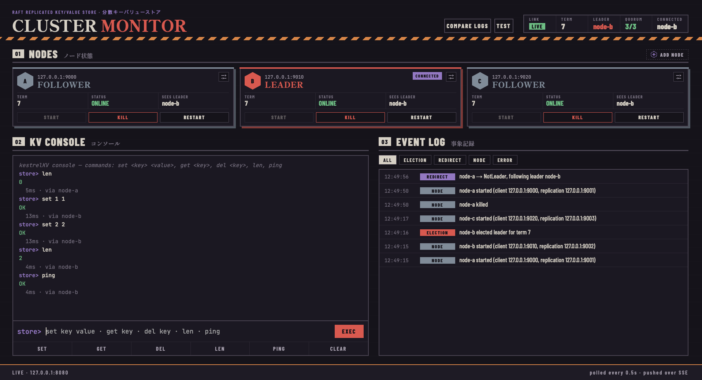

# kestrelKV

kestrelKV is a key-value store with a durable write-ahead log (WAL), snapshot-based log compaction, and a custom binary TCP protocol for clients and peer replication. It runs as a cluster that replicates every write with Raft consensus, so data survives node crashes and the cluster keeps serving requests as long as a majority of nodes are up — zero dependencies, pure Go standard library.

## Start the servers

Start node A:

```bash
cd cmd/server
go run . \
  -node-id=node-a \
  -verbose \
  -client-addr=:9000 \
  -replication-addr=:9001 \
  -wal=data/node-a.wal \
  -peers=node-b=127.0.0.1:9002,node-c=127.0.0.1:9003 \
  -client-peers=node-b=127.0.0.1:9010,node-c=127.0.0.1:9020
```

To start nodes B and C, run the same command in another terminal and change these flags:

- **Node B:** `-node-id=node-b`, `-client-addr=:9010`, `-replication-addr=:9002`, `-wal=data/node-b.wal`
- **Node C:** `-node-id=node-c`, `-client-addr=:9020`, `-replication-addr=:9003`, `-wal=data/node-c.wal`

In `-peers` and `-client-peers`, list the other two nodes and leave out the node you are starting. Replication ports are A `9001`, B `9002`, C `9003`. Client ports are A `9000`, B `9010`, C `9020`.

Raft elects the leader on its own. `-client-peers` lets a follower send the client to the leader, and if the leader dies the client moves to the new one. `-verbose` turns logging on. Add `-pprof-addr=127.0.0.1:8080` for profiling, with a different port for each node.

## Run client

Connect with every client port. A write sent to a follower is retried on the leader, and a dead leader is replaced by whichever node wins the next election:

```bash
cd client
go run . --9000 --9010 --9020
```

Examples: `set foo bar`, `get foo`, `del foo`, `len`, `ping`, `quit`.

## Run the client UI

The UI is a web monitor that starts and manages the nodes for you, so you don't need the three server terminals. Run it from anywhere in the repo:

```bash
go run ./cmd/ui
```

Then open http://127.0.0.1:8080. Use `-addr` to pick another address, or `-server-bin` to use a server binary you already built.

This opens a UI where you can start, stop and restart nodes, add, edit and remove nodes, and run commands against the cluster.

> **Note:** The UI uses HTTP, not the custom TCP protocol, because browsers can't open raw TCP connections. Don't use it for performance testing.



<!--
## Install from a release

The server and the client are installed separately, each with its own script. Both download a prebuilt binary from GitHub Releases (Linux or macOS, amd64/arm64) over HTTPS, verify its SHA-256 checksum, and install to `/usr/local/bin` (using `sudo` only if needed). Override the location with `BIN_DIR=...`.

Both `kestrel` and `kestrel-cli` require `settings.properties` at startup (there are no built-in defaults). When running outside this repository, either point `KVSTORE_SETTINGS=/path/to/settings.properties` at a copy of the file or place `settings.properties` in your working directory (or alongside the binary).

### Server

```bash
./deploy/install-server.sh          # latest release
./deploy/install-server.sh v0.1.0   # specific version
```

Installs `kestrel` and creates a WAL directory at `~/.kestrel` (`/var/lib/kestrel` when run as root; override with `DATA_DIR=...`). It does not start the server; run `kestrel` with your own flags, e.g. `--wal=$HOME/.kestrel/node-a.wal`.

To uninstall, including WAL data:

```bash
kestrel-uninstall --purge
```

Without `--purge` it removes the binary but keeps the WAL directory.

### Client

```bash
./deploy/install-client.sh          # latest release
./deploy/install-client.sh v0.1.0   # specific version
```

Installs `kestrel-cli`. Connect to a cluster (defaults to `localhost:9000`):

```bash
kestrel-cli --9000 --9010 --9020
kestrel-cli --host-a:9000,host-b:9000,host-c:9000
```

To uninstall:

```bash
kestrel-cli-uninstall
```
-->

## Run all tests

Run all integration, correctness, fault-tolerance, and benchmark suites under `test/` from the repo root:

```bash
KV_BENCH=1 go test -v -count=1 -p 1 -timeout 30m ./test/...
```

- `KV_BENCH=1` — enables the slow cluster and benchmark tests (skipped by default) and updates each suite's `results.md`.
- `-v` — prints verbose output as each test runs.
- `-count=1` — disables Go's test cache so every test runs fresh.
- `-p 1` — runs one package at a time so cluster and perf suites don't compete for CPU/disk and skew results.
- `-timeout 30m` — raises Go's default 10-minute per-package timeout for longer suites.
- `./test/...` — runs every test package under `test/` (use `./test/multi/...` for multi-node suites only).

## Important commands to know

From `cmd/server`:

```bash
ls -l data/node-a.wal-raft.log data/node-a.wal-raft.snap                   # list segments and snapshot
diff -r data/node-a.wal-raft.log data/node-b.wal-raft.log                  # compare two nodes' logs
xxd data/node-a.wal-raft.log/00000000000000000001.wal | head               # inspect raw segment bytes
```
