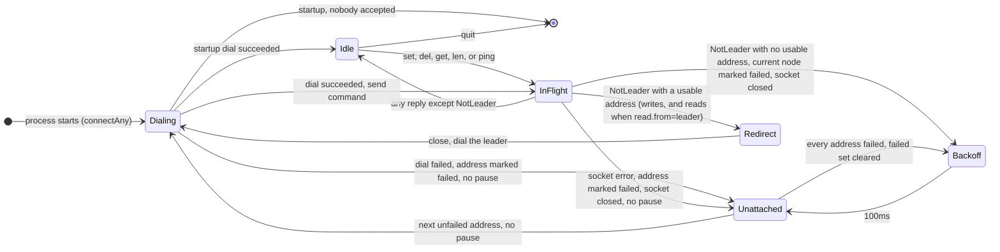

# Client to server connection

The CLI keeps one TCP connection and a list of client addresses (`--9000 --9010 --9020`, or `localhost:9000` when none are given). Startup dials the first member that accepts. A later `SET` or `DEL` is what moves that connection onto the leader. `GET` and `LEN` read the connected node's local store by default, or follow the same redirect to the leader when `server.read.from=leader`. `PING` always stays on the connected node.

**Backoff** is the 100ms `redirectPause`. It happens in exactly two places: after a `NotLeader` that gives no usable leader address, and when every known address is in the failed set (the set is cleared, then the next address is dialed). Socket errors and failed dials do not pause; the client moves straight to the next unfailed address.

**Unattached** means no open socket during a command.

The retry loop in `session.Do` runs until `client.retry.window.ms` (5s) passes. The window is checked only at the top of the loop, so a pause or dial in progress can finish after it. When the loop ends:

- If any dial or socket error happened, that last error is returned and printed as `request error: ...`.
- If the only thing seen was `NotLeader` with no usable address, the command returns a `NotLeader` response and prints `not leader; leader unknown`. No error is reported.

The socket is whatever state the last iteration left. It is closed if the last step was a failure, but open if a redirect dial just succeeded. The next command starts from that state.

## Read setting

`server.read.from` in `settings.properties` decides where `GET` and `LEN` are answered. The server enforces it, and the client simply follows any `NotLeader` it receives.

| Value | Behaviour |
|---|---|
| `any` (default) | The connected node answers from its own store. A follower can be behind the leader. |
| `leader` | A node that is not the Raft leader answers `NotLeader` plus the leader's client address, and the client redirects and resends, exactly as for a write. Only the leader reads. |

`leader` removes follower staleness but is not fully linearizable: a deposed leader that has not yet noticed can still answer briefly. `PING` is never redirected.

`NotLeader` carries the leader's client address when this node has it in `-client-peers`. When the leader is known only by node id, the id is sent instead. An empty value means no leader is known yet. A bare node id is not dialable (`host:port` is required), so the client treats it the same as an empty hint.

A hint is also unusable when it equals the address the client is already on, or when that address is already in the failed set. The client then marks the current node failed, closes the socket, pauses 100ms, and dials the next unfailed address.

A usable hint prints `switching to leader <addr>`, closes the socket, and dials it. If that dial fails the address is marked failed, with no pause. Every address the client connects to is added to its member list, so a redirect target can be dialed again later.

Startup (`connectAny`) tries each address once, in the order given, and exits with `connect error` if nobody accepts. The 5s window and the 100ms pause apply only after a command has started (`session.Do`).

Inside `Do`, addresses are picked by `nextAddr`, which walks the member list with a cursor that persists across commands. It skips failed addresses, so it does not always begin at the first one. The failed set is created fresh for each command.

## Server side

A node in a Raft cluster decides leadership from its Raft state, not from a startup role. A write on a non-leader returns `NotLeader` with the leader's address. A standalone node with no Raft state answers from its configured role: a leader applies the write directly, and a follower returns its configured leader address.

## First connection, then the leader

1. **Dialing → Idle.** Dial members in the order given. Stay on the first node that accepts, whether it is the leader or a follower.
2. The first `SET` or `DEL` goes out on that socket.
3. A follower answers `NotLeader` plus the leader's client address. **InFlight → Redirect → Dialing → InFlight** resends the same write.
4. The leader answers `OK`. The session stays **Idle** on that address, so later commands start there.

With `server.read.from=any`, a `GET` during this phase does not take the redirect and is answered by whichever node accepted the first dial. With `leader`, it redirects like a write.

## Normal set

**Idle → InFlight → Idle**, on the leader.

The leader proposes the entry and answers `OK` only after a majority has it and this node has applied it. The client prints `OK` and keeps the socket.

A commit timeout (`server.raft.propose.timeout.ms`) comes back as a server error. It is final: the client does not look for another node.

If the node loses leadership while the write is in flight, or was not the leader to begin with, it answers `NotLeader`. The client then follows the redirect path and resends the same write.

## Normal get

**Idle → InFlight → Idle**, on the current node.

With `server.read.from=any`, any member serves `GET` from its own store. `OK` prints the value. A missing key is `NotFound` and prints `key not found`. Neither status moves the connection. A follower can therefore answer a read that is behind a write the leader has already acknowledged.

With `server.read.from=leader`, a node that is not the leader answers `NotLeader` and the read follows the redirect path, so the answer comes from the leader.

`LEN` follows the same rule. `PING` always uses the connected node.

## Leader stopped

The dead leader's next read or write returns a socket error.

1. **InFlight → Unattached.** That address is marked failed and the socket is closed. There is no pause.
2. **Unattached → Dialing.** The next address that is not in the failed set is dialed and the same command is sent. A failed dial marks that address failed and tries the next, again with no pause.
3. A survivor that is already the new leader answers `OK` for a write, or serves a read locally. The session is **Idle** on that node.
4. A survivor that is still a follower answers a write with `NotLeader` and the new leader's client address. **Redirect → Dialing** follows it and resends the write.
5. If the hint is empty, a node id, the current address, or an address already marked failed, **InFlight → Backoff**. The current node stays failed. After 100ms the client dials the next address that is not failed.
6. When no such address remains, **Unattached → Backoff** clears the failed set, sleeps 100ms, and tries the list again. The command stops when it succeeds or the 5s window ends, as described under the diagram.

With `server.read.from=any`, a `GET` uses steps 1–3 only. It is answered by the next node that accepts the dial and does not chase a `NotLeader` hint. With `leader`, steps 4–6 apply to reads too.
