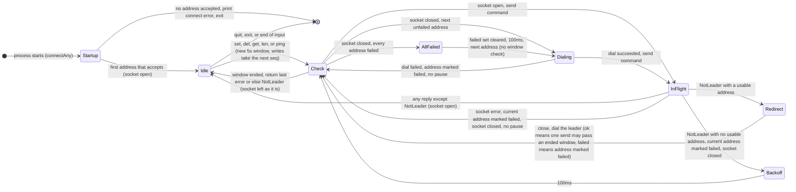

# Client to server connection

The CLI (`client/main.go`) keeps one TCP connection and a list of client addresses (`--9000 --9010 --9020`, `--9000,9010`, `--host:port`, or `localhost:9000` when none are given). Startup dials the first member that accepts. A later `SET` or `DEL` is what moves that connection onto the leader. `GET` and `LEN` read the connected node's local store by default, or follow the same redirect to the leader when `server.read.from=leader`. `PING` always stays on the connected node.

The diagram follows `connectAny` and the loop in `session.Do` step by step. **Check** is the top of that loop, where the retry window is tested.

**Pauses.** The 100ms `client.redirect.pause.ms` happens in exactly two places:

- **Backoff**: after a `NotLeader` that gives no usable leader address. The sleep ends at **Check**, so the window is tested before the next dial.
- **AllFailed**: when every known address is in the failed set. The set is cleared, the client sleeps, and the next address is dialed straight away, without going back to **Check**.

Socket errors and failed dials do not pause. The client moves straight to the next unfailed address. Each dial has its own `client.dial.timeout.ms` (1s) limit, at startup too.

**Retry window.** The loop runs until `client.retry.window.ms` (5s) passes. The window is tested only at **Check**, so a pause or dial in progress can finish after it, and the AllFailed dial skips the test. One exception: when **Redirect** has just connected to the leader, the command is sent there even if the window has ended, so a command that found the leader does not end as "leader unknown". That happens at most once per command, so two nodes naming each other cannot keep the client looping. When the loop ends:

- If any dial or socket error happened, that last error is returned and printed as `request error: ...`.
- Otherwise the command returns a bare `NotLeader` response and prints `not leader; leader unknown`. No error is reported.

**Socket state between commands.** The socket is whatever the last pass left. It is open after a normal reply. It is closed after a socket error, a failed dial or a Backoff. It is also open when the window ended right after a Redirect connected and the one late send was already used. The next command starts at **Check** from that state, and dials first if the socket is closed.

## Retries are applied once

A write can be sent more than once: after a socket error, after `NotLeader`, or by the user after a commit timeout. The first attempt may already be in the Raft log and commit later, so without protection a retry could be applied twice, or an old write could land after a newer one.

- At startup the client picks a random non-zero 64-bit client id (`newClientID`). Id 0 means "no dedup" on the server.
- Each `SET` or `DEL` gets the next sequence number (1, 2, 3, ...) when `Do` starts. Every attempt of that write, on any node, sends the same id and number. Reads and `PING` carry none.
- The id and number travel in the request, the Raft log entry, the replication RPC and the WAL record.
- `server.StateMachine` applies committed entries. It keeps the highest number applied per client and skips any write whose number is not above it. The skipped retry is still logged, committed and answered `OK`.
- Every node applies the same log in the same order, so every node skips the same entries.
- The table is saved in every snapshot next to the key-value pairs and restored with it (`BeginSnapshot` / `RestoreSnapshot`). After a restart, log compaction or an `InstallSnapshot`, it is rebuilt from the snapshot plus the log entries after it, together with the store.
- The table keeps one entry per client id that ever wrote and is never trimmed.
- A user who types the same `SET` again sends a new number, so it is applied again. Only automatic retries of one command are deduplicated.

## Read setting

`server.read.from` in `settings.properties` decides where `GET` and `LEN` are answered. Any other value makes the server panic at startup. The server enforces it, and the client simply follows any `NotLeader` it receives.

| Value | Behaviour |
|---|---|
| `any` (default) | The connected node answers from its own store. A follower can be behind the leader. |
| `leader` | A node that is not the Raft leader answers `NotLeader` plus the leader's address, and the client redirects and resends, exactly as for a write. The leader serves the read only after `WaitLeaderRead` (Raft ReadIndex): it waits for an entry from its own term to commit, records that commit index, confirms it is still leader with a fresh heartbeat round to a majority, then waits until it has applied up to that index. All of this must finish within `server.raft.propose.timeout.ms`. If it stops being leader on the way, it answers `NotLeader`. Any other failure, the timeout included, is a server error `timed out waiting for the leader to catch up`. |

With `leader`, reads are linearizable. A deposed leader that has not noticed yet cannot answer, because its heartbeat round fails to reach a majority in its term. `PING` is never redirected.

`NotLeader` carries the leader's client address when this node has it in `-client-peers` (each node also maps its own id to its own listen address). When the leader is known only by node id, the id is sent instead. An empty value means no leader is known yet. A bare node id is not dialable (`dialableAddr` requires `host:port`), so the client treats it the same as an empty hint.

A hint is also unusable when it equals the address the client last connected to, or when that address is already in the failed set. The client then marks the current node failed, closes the socket and goes to **Backoff**.

A usable hint prints `switching to leader <addr>`, closes the socket, and dials it. If that dial fails the address is marked failed, with no pause. Every address the client connects to is added to its member list, so a redirect target can be dialed again later.

These comparisons are plain string matches after `dialableAddr`, which only fills in an empty host as `127.0.0.1`. The client keeps `--9000` as `localhost:9000`, but the server builds hints with `dialableClientAddr`, which turns a listen address like `:9000` or `0.0.0.0:9000` into `127.0.0.1:9000`. The two spellings of one node do not match. So a hint naming a dead leader under the other spelling is not "already failed": the client prints `switching to leader`, the dial fails, and that spelling is marked failed with no pause. Only the next hint, now in the failed set, goes to Backoff. The member list can also hold both spellings of the same node. Writing `-client-peers` with the same host form the client uses avoids this.

Startup (`connectAny`) tries each address once, in the order given, and exits with `connect error` if nobody accepts. The 5s window and the 100ms pause apply only after a command has started (`session.Do`).

Inside `Do`, addresses are picked by `nextAddr`, which walks the member list with a cursor that persists across commands. It skips failed addresses, so it does not always begin at the first one. Redirects and startup dial directly and do not move the cursor. The failed set is created fresh for each command.

## Server side

Every node runs Raft, and the client server (`server.New`) requires a Raft node. Leadership comes from the node's current Raft state. A write on a non-leader returns `NotLeader` with the leader's address. A single node started with no `-peers` has quorum 1, so it elects itself and handles writes the same way.

The monitor UI's HTTP listener (`-ui-addr`) calls `Server.Do`, which runs the same `dispatch` as a TCP client command, so its requests get the same answers.

## First connection, then the leader

1. **Startup → Idle.** Dial members in the order given. Stay on the first node that accepts, whether it is the leader or a follower.
2. The first `SET` or `DEL` goes out on that socket (**Idle → Check → InFlight**).
3. A follower answers `NotLeader` plus the leader's client address. **InFlight → Redirect → Check → InFlight** resends the same write on the new socket.
4. The leader answers `OK`. The session goes back to **Idle** on that address, so later commands start there.

With `server.read.from=any`, a `GET` during this phase does not take the redirect and is answered by whichever node accepted the first dial. With `leader`, it redirects like a write.

## Normal set

**Idle → Check → InFlight → Idle**, on the leader.

The leader proposes the entry and answers `OK` only after a majority has it and this node has applied it. The client prints `OK` and keeps the socket.

A commit timeout (`server.raft.propose.timeout.ms`) comes back as a server error `timed out waiting for the write to commit`. It is a normal reply, so the client does not look for another node. The write may still commit later. Retrying it by hand sends a new sequence number, so it is a second write.

If `Propose` fails with anything other than not-leader, lost leadership or the timeout (for example the leader cannot write the entry to its WAL), `dispatch` passes the error up and `handleConn` closes the client connection without a reply. The client sees a socket error, so it takes **InFlight → Check**, marks that node failed, and resends the same write (same id and number) elsewhere.

If the node loses leadership while the write is in flight, or was not the leader to begin with, it answers `NotLeader`. The client then follows the redirect path and resends the same write with the same client id and sequence number. If the first attempt also commits, the state machine applies only one of them (see "Retries are applied once").

## Normal get

**Idle → Check → InFlight → Idle**, on the current node.

With `server.read.from=any`, any member serves `GET` from its own store. `OK` prints the value. A missing key is `NotFound` and prints `key not found`. Neither status moves the connection. A follower can therefore answer a read that is behind a write the leader has already acknowledged.

With `server.read.from=leader`, a node that is not the leader answers `NotLeader` and the read follows the redirect path, so the answer comes from the leader.

`LEN` follows the same rule. `PING` always uses the connected node.

## Leader stopped

The dead leader's next read or write returns a socket error.

1. **InFlight → Check.** That address is marked failed and the socket is closed. There is no pause.
2. **Check → Dialing.** The next address that is not in the failed set is dialed and the same command is sent. A failed dial marks that address failed and goes back to **Check**, again with no pause.
3. A survivor that is already the new leader answers `OK` for a write, or serves a read locally. The session is **Idle** on that node.
4. A survivor that is still a follower answers a write with `NotLeader` and the new leader's client address. **Redirect** follows it and resends the write.
5. If the hint is empty, a node id, the current address, or an address already marked failed (compared as strings, see "Read setting"), **InFlight → Backoff**. The current node stays failed. After 100ms, **Check** dials the next address that is not failed.
6. When no such address remains, **Check → AllFailed** clears the failed set, sleeps 100ms, and dials the list again from the cursor. The command stops when it succeeds or the 5s window ends, as described under the diagram.

With `server.read.from=any`, a `GET` uses steps 1–3 only. It is answered by the next node that accepts the dial and does not chase a `NotLeader` hint. With `leader`, steps 4–6 apply to reads too.
