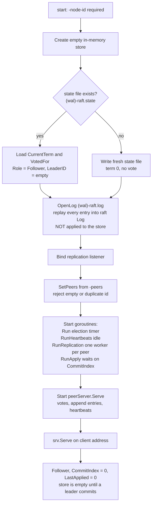
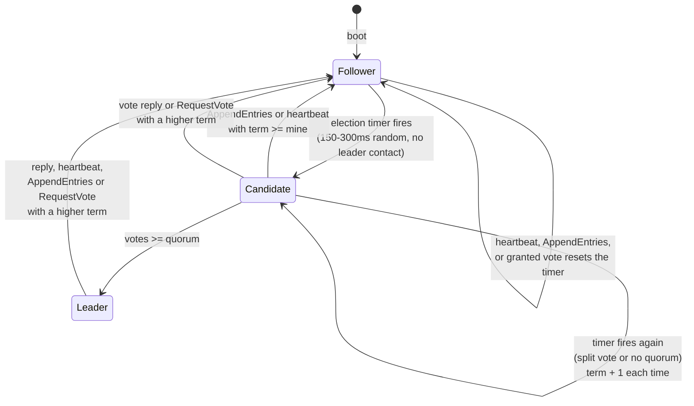
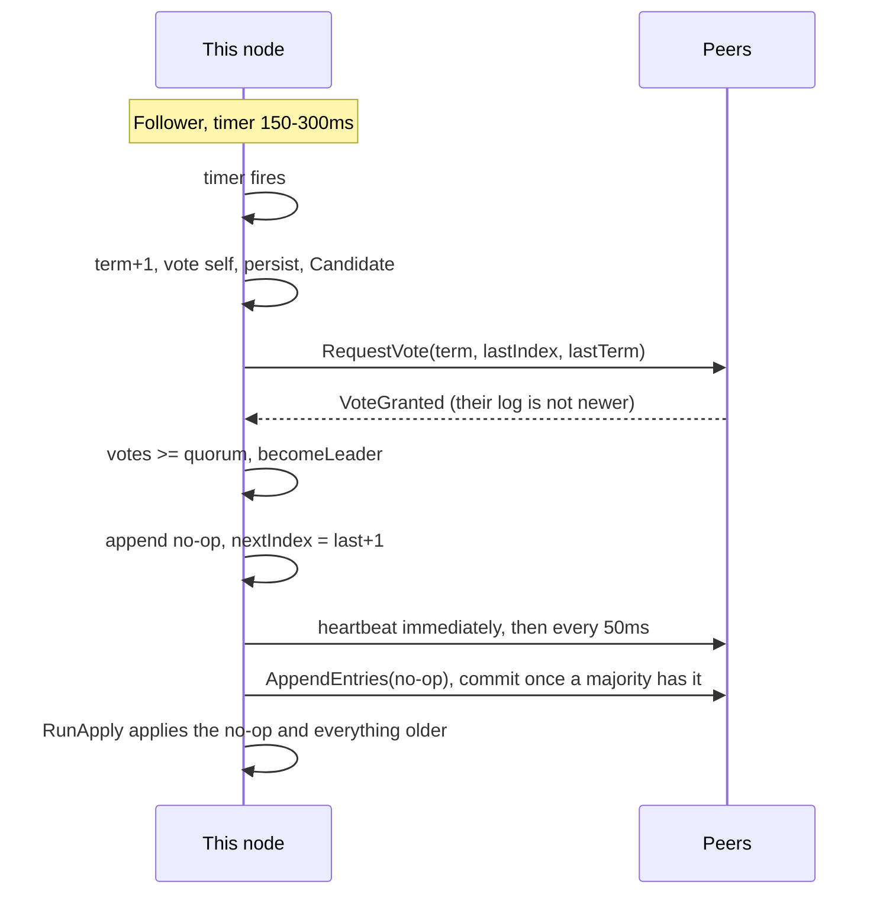
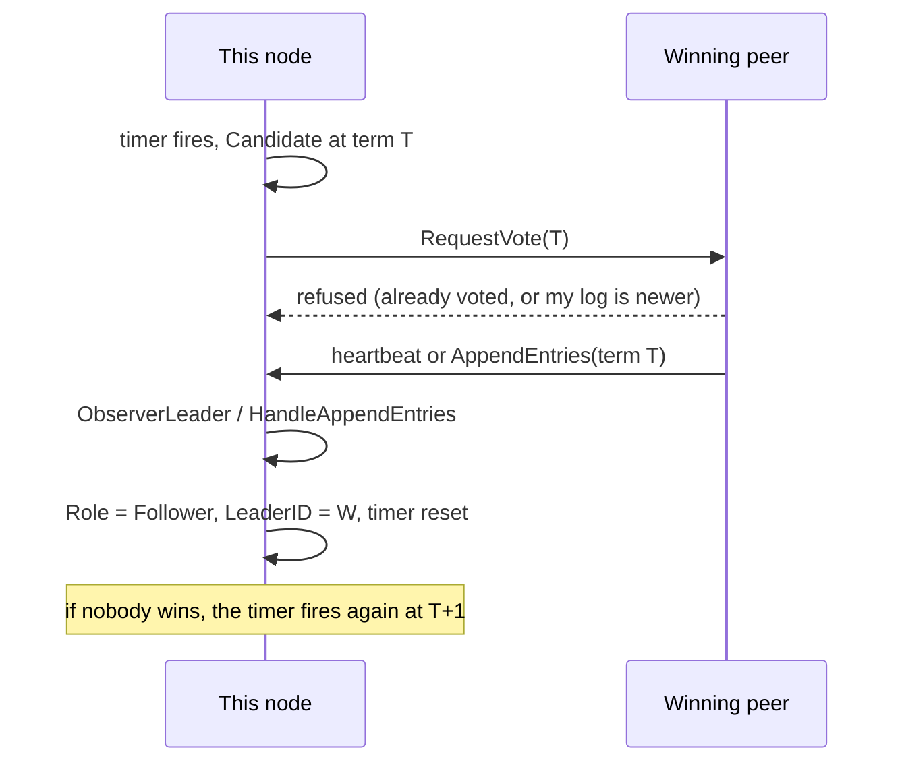

# Node startup and election

Every node runs the same code. [cmd/server/main.go](../cmd/server/main.go) has no `-role` flag: each node boots as a **Follower** and Raft decides the leader at runtime. A restart repeats the same boot, whatever the node was before.

## 1. Boot sequence (`runNode`)

Facts that matter here:

- **Persisted:** term and `votedFor` (state file) and the log (WAL).
- **Not persisted:** `CommitIndex` and `LastApplied`. A restarted node always begins at 0 and rebuilds its store only after a leader tells it what is committed. Until then `GET` on this node can return `key not found`.
- Peer RPC errors at startup are ignored. The node boots even if no peer is up.

## 2. Role state machine

### Follower
- Election timer is armed from `Run` and reset by `pokeElectionTimer`. It is poked by a valid heartbeat (`ObserverLeader`), by `AppendEntries` with `term >= mine`, and by a **granted** vote.
- A vote request with a higher term moves the term forward. If the candidate's log is up to date, the vote is recorded. If it is outdated, the new term is stored with an empty `votedFor` (no vote is recorded). A refused vote does not reset the timer.
- Learns the leader through `ObserverLeader` or `HandleAppendEntries`. This sets `LeaderID`, which clients get back as the redirect hint.

### Candidate (`startElection`)
1. `term = CurrentTerm + 1`. Write term and `votedFor = self` to disk first.
2. Role = Candidate, `LeaderID` cleared.
3. Votes = 1 (self). If `quorum` is 1, `becomeLeader` runs right away. This is the single-node cluster.
4. Otherwise send `RequestVote` (term, last log index and term) to every peer in parallel.
5. A reply with a higher term cancels the election and calls `stepDown`. A grant increments votes, and reaching the quorum cancels the other RPCs.
6. After all RPCs return: quorum met means `becomeLeader`. Otherwise nothing happens and the node stays Candidate until the timer fires and a new election starts.

### Leader (`becomeLeader`)
- Sets `nextIndex = lastIndex + 1` and `matchIndex = 0` for each peer.
- Appends a **no-op** entry in the new term, so earlier-term entries commit with it. A single node commits it immediately.
- Wakes the replication workers and the heartbeat loop.
- The election timer fires but does nothing while Leader (`continue`, no reset). It is re-armed when the node stops being leader.
- Heartbeats go to each peer every `electionTimeoutMin / 3` (50ms).

## 3. Startup scenarios

### A. No leader yet, this node wins

### B. No leader yet, this node loses

A candidate that sees a **higher** term from a vote reply or request calls `stepDown` or `recordVote`. Both set Role = Follower and clear `LeaderID`.

### C. A leader already exists, this node joins or restarts
1. Boot as Follower with the stored term. The timer is armed.
2. The leader's heartbeat or `AppendEntries` arrives, usually before 150ms, and `ObserverLeader` or `HandleAppendEntries` adopts the term and the leader.
3. If the leader has entries this peer lacks, it sends them. If not, its idle commit refresh sends an empty `AppendEntries` within `electionTimeoutMin`. Either way the RPC is checked against `PrevLogIndex` and `PrevLogTerm`. On failure the leader decrements `nextIndex` by one and retries. The follower truncates a divergent suffix.
4. The commit index arrives in `LeaderCommit`, capped at what this RPC matched. `RunApply` then replays entries from 1 into the store, one at a time.

### D. The restarted node was the old leader
- Boots as Follower. The stored term may be stale.
- A heartbeat or `AppendEntries` carrying a higher term makes it adopt that term (`SetPersistentState(term, "")`), set `LeaderID`, and follow.
- A vote request carrying a higher term also makes it adopt that term, but through `recordVote`: if the candidate's log is up to date it stores a vote for that candidate, otherwise an empty vote. `LeaderID` stays empty until a heartbeat or `AppendEntries` arrives.
- If the timer fires first, it runs an election at `term + 1`. It wins only if peers judge its log at least as up to date (`LogIsUptoDate`: higher last term wins, then higher last index).

### E. Cluster-wide cases
| Case | What the code does |
|---|---|
| Split vote | No candidate reaches quorum. Each waits out a new random timeout and retries at term + 1. |
| Only a minority is up | Nobody reaches quorum. Candidates keep retrying and terms keep growing. Clients get `NotLeader` with an empty hint. |
| All nodes cold-start together | Same as a split vote. The random timeout breaks the tie. |
| Peer down during election | The `RequestVote` error is dropped and that peer counts as no vote. |
| Bad `-peers` | `NewPeerSet` fails at boot on a spec with no `=`, an empty id or address, or a duplicate id. `SetPeers` also rejects a peer id equal to this node's own id. The address is not checked to be `host:port`: `n2=garbage` boots, and only that peer's RPCs fail later, when they dial it. |
| Bad `-client-peers` | `clientAddrMap` fails at boot on a spec with no `=`, or an empty id or address. The address is not checked to be `host:port`; a bad one is handed to clients as a hint, which the client treats as unusable. |
| Torn WAL tail (incomplete last record) | `Replay` truncates the incomplete record and boot continues. |
| Corrupt state file, corrupt WAL record, or out-of-order WAL index | `OpenNode` or `OpenLog` returns an error and the process exits. |
| State file missing or older than the log (last log term > stored term) | `OpenLog` returns `ErrLogAheadOfState` and the process exits. Remove both files to rejoin as an empty node. |

## 4. What a restart does and doesn't keep

| Item | After restart |
|---|---|
| `CurrentTerm`, `VotedFor` | kept (state file, synced before any vote reply) |
| Raft log | kept (WAL replay) |
| `CommitIndex`, `LastApplied` | reset to 0 |
| In-memory KV store | empty, rebuilt by `RunApply` after a leader sends `LeaderCommit` |
| Role, `LeaderID` | Follower, empty |
