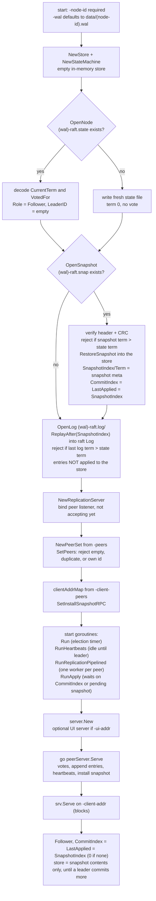
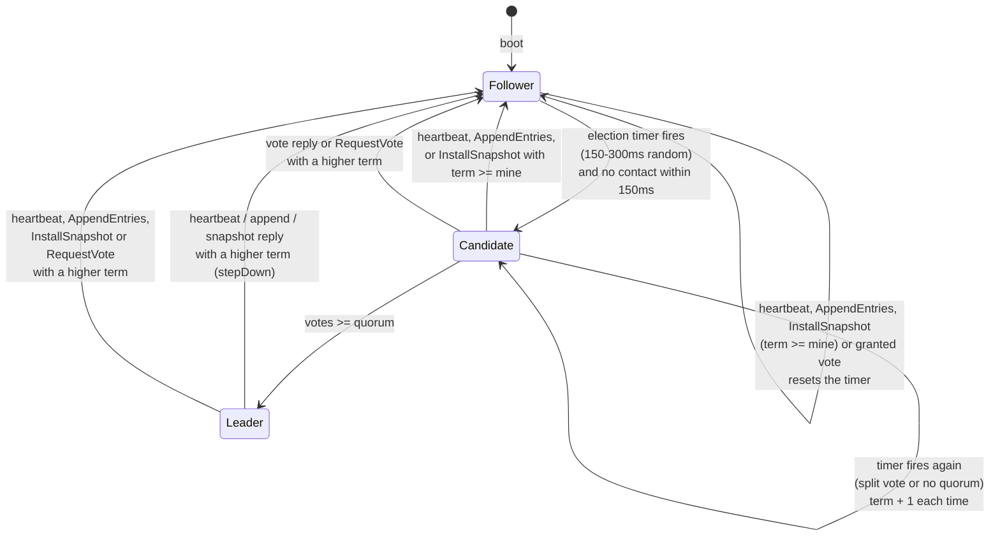
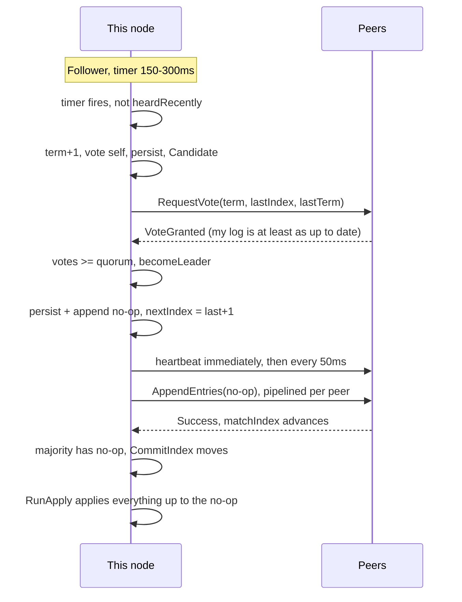
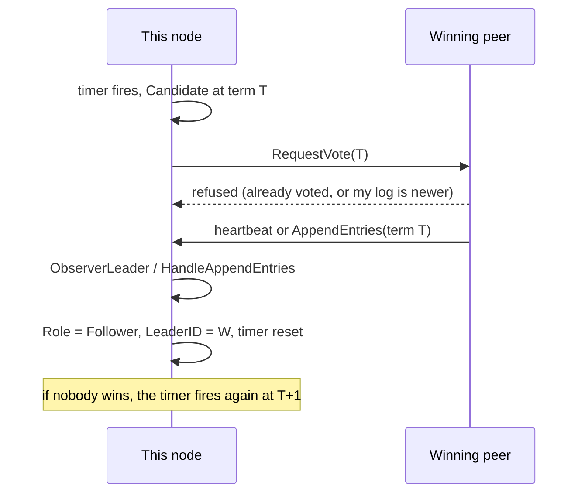

# Node startup and election

Every node runs the same code. [cmd/server/main.go](../cmd/server/main.go) has no `-role` flag: each node boots as a **Follower** and Raft decides the leader at runtime. A restart repeats the same boot, whatever the node was before.

On-disk files, all derived from `-wal` (default `data/<node-id>.wal`):

| Path | Holds | Written by |
|---|---|---|
| `<wal>-raft.state` | `CurrentTerm`, `VotedFor` | `writePersistentState` (temp file, fsync, rename, dir fsync) |
| `<wal>-raft.snap` | latest snapshot: header (magic, version, last index, last term), store payload, CRC32 | `finishLocalSnapshot` or `HandleInstallSnapshot` |
| `<wal>-raft.log/` | WAL directory of segment files `<20-digit seq>.wal` | `persistAppend*`, `persistTruncateLocked`, `Compact` |

## 1. Boot sequence (`runNode`)

Facts that matter here:

- **Persisted:** term and `votedFor` (state file), the snapshot (snap file), and the log suffix after compaction (WAL segments).
- **Not persisted:** `CommitIndex` and `LastApplied` themselves. A restart sets both to `SnapshotIndex` (0 with no snapshot). Entries after the snapshot are in the raft log but are applied only after a leader says they are committed. Until then `GET` on this node can return a stale value or `key not found`.
- `OpenLog` only loads entries with index > `SnapshotIndex`. If a snapshot exists and the WAL has nothing after it, leftover segments are cleaned with `ResetAfter(SnapshotIndex)` (crash right after an install).
- Peer RPC errors at startup are ignored. The node boots even if no peer is up.
- With no peers, `RunReplicationPipelined` returns at once and quorum is 1.

## 2. Role state machine

### Election timer (`Run`)
- Armed with `randomElectionTimeout()` (150-300ms, from `settings.properties`). `pokeElectionTimer` records `lastHeard` and re-arms it.
- When it fires: Leader → `continue` with the timer left stopped. If `heardRecently()` (contact within `electionTimeoutMin`, 150ms) → re-arm only. Otherwise → `startElection`, then re-arm.
- `startElection` re-checks `Leader` and `heardRecently()` under the lock before bumping the term.

### Follower
- The timer is poked by a heartbeat (`ObserverLeader`) with `term >= mine`, by `HandleAppendEntries` with `term >= mine` (even if the prev-log check then fails), by `HandleInstallSnapshot` with `term >= mine`, and by a **granted** vote.
- A vote request with a higher term moves the term forward through `recordVote`. If the candidate's log is up to date, the vote is recorded. If not, the new term is stored with an empty `votedFor`. A refused vote does not reset the timer.
- Same-term vote: refused if the log is outdated or `votedFor` is another candidate.
- Learns the leader through `ObserverLeader`, `HandleAppendEntries` or `HandleInstallSnapshot`. This sets `LeaderID`, which clients get back as the redirect hint.

### Candidate (`startElection`)
1. `term = CurrentTerm + 1`. `SetPersistentState(term, self)` writes term and vote to disk first.
2. If the term or vote changed meanwhile, abort. Otherwise Role = Candidate, `LeaderID` cleared.
3. Votes = 1 (self). If `quorum` is 1, `becomeLeader` runs right away. This is the single-node cluster.
4. Otherwise send `RequestVote` (term, last log index and term, falling back to `SnapshotIndex/Term` when the log is empty) to every peer in parallel.
5. A reply with a higher term records it and cancels the other RPCs. A grant increments votes, and reaching the quorum cancels the other RPCs. RPC errors count as no vote.
6. After all RPCs return: a higher term means `stepDown`. Quorum met means `becomeLeader`. Otherwise the node stays Candidate until the timer fires and a new election starts.

### Leader (`becomeLeader`)
- Only if still Candidate in that term. Sets Role = Leader, `LeaderID` = self.
- Sets `nextIndex = lastIndex + 1` and `matchIndex = 0` for each peer.
- Appends a **no-op** entry in the new term (WAL first), so earlier-term entries commit with it. `advanceCommitLocked` commits it immediately on a single node.
- Wakes the per-peer replication workers and the heartbeat loop (`leaderWake`).
- The election timer stays stopped while Leader. Every path out of Leader pokes it to re-arm.
- Heartbeats go to each peer immediately, then every `electionTimeoutMin / 3` (50ms). Heartbeats carry only term and leader id, not the commit index.

## 3. Startup scenarios

### A. No leader yet, this node wins

### B. No leader yet, this node loses

A candidate that sees a **higher** term from a vote reply calls `stepDown`; from a vote request it calls `recordVote`. Both set Role = Follower and clear `LeaderID`.

### C. A leader already exists, this node joins or restarts
1. Boot as Follower with the stored term, snapshot restored, log suffix loaded. The timer is armed.
2. The leader's heartbeat or `AppendEntries` arrives, usually before 150ms, and `ObserverLeader` or `HandleAppendEntries` adopts the term and the leader.
3. The leader's worker for this peer sends what the peer lacks. If it has nothing new, the idle **commit refresh** sends an empty `AppendEntries` (prev = `matchIndex`) every `commitRefreshInterval` (`electionTimeoutMin`, 150ms).
4. The follower checks `PrevLogIndex`/`PrevLogTerm` (or the snapshot boundary if `PrevLogIndex < SnapshotIndex`). On failure the leader's worker rewinds `nextIndex` to the failed `PrevLogIndex` (one step back), drops in-flight sends and probes again. The follower truncates a divergent suffix from the WAL and memory.
5. If the entry the leader needs is already compacted on the leader, it streams its snapshot file in chunks (`sendSnapshotToPeer`). The follower writes it to a temp file, verifies it, renames it over `<wal>-raft.snap`, keeps or drops its log suffix, compacts or resets the WAL, and sets a pending snapshot. `RunApply` restores it into the store.
6. The commit index arrives in `LeaderCommit`, capped at what this RPC matched. `RunApply` then applies entries from `LastApplied + 1` into the store, in batches.

### D. The restarted node was the old leader
- Boots as Follower. The stored term may be stale.
- A heartbeat, `AppendEntries` or `InstallSnapshot` carrying a higher term makes it adopt that term (`SetPersistentState(term, "")`), set `LeaderID`, and follow.
- A vote request carrying a higher term also makes it adopt that term, but through `recordVote`: if the candidate's log is up to date it stores a vote for that candidate, otherwise an empty vote. `LeaderID` stays empty until a heartbeat or `AppendEntries` arrives.
- If the timer fires first, it runs an election at `term + 1`. It wins only if peers judge its log at least as up to date (`LogIsUptoDate`: higher last term wins, then higher last index).

### E. Cluster-wide cases
| Case | What the code does |
|---|---|
| Split vote | No candidate reaches quorum. Each waits out a new random timeout and retries at term + 1. |
| Only a minority is up | Nobody reaches quorum. Candidates keep retrying and terms keep growing. Clients get `NotLeader` with an empty hint. |
| All nodes cold-start together | Same as a split vote. The random timeout breaks the tie. |
| Peer down during election | The `RequestVote` error is dropped and that peer counts as no vote. |
| Bad `-peers` | `NewPeerSet` fails at boot on a spec with no `=`, an empty id or address, or a duplicate id. `SetPeers` also rejects an empty id or a peer id equal to this node's own id. The address is not checked to be `host:port`: `n2=garbage` boots, and only that peer's RPCs fail later, when they dial it. |
| Bad `-client-peers` | `clientAddrMap` fails at boot on a spec with no `=`, or an empty id or address. The address is not checked to be `host:port`; a bad one is handed to clients as a hint, which the client treats as unusable. |
| Torn WAL tail (incomplete last record in the last segment) | `ReplayAfter` truncates the incomplete record and boot continues. An incomplete record in an earlier segment is an error. |
| Corrupt state file, bad WAL segment header, corrupt WAL record, or out-of-order WAL index | `OpenNode` or `OpenLog` returns an error and the process exits. |
| Corrupt snapshot (too small, bad magic or version, zero index, CRC mismatch) | `OpenSnapshot` returns `ErrCorruptSnapshot` and the process exits. |
| State file missing or older than the data (snapshot term or last log term > stored term) | `OpenSnapshot` or `OpenLog` returns `ErrLogAheadOfState` and the process exits. Remove the state file, the snap file and the log directory to rejoin as an empty node. |

## 4. What a restart does and doesn't keep

| Item | After restart |
|---|---|
| `CurrentTerm`, `VotedFor` | kept (state file, synced before any vote reply) |
| Snapshot | kept (`<wal>-raft.snap`), restored into the store at boot |
| Raft log | entries after `SnapshotIndex` kept (WAL replay) |
| `CommitIndex`, `LastApplied` | reset to `SnapshotIndex` (0 with no snapshot) |
| In-memory KV store | snapshot contents; the rest rebuilt by `RunApply` after a leader sends `LeaderCommit` |
| Role, `LeaderID` | Follower, empty |
| `nextIndex`, `matchIndex`, in-flight pipeline | gone; rebuilt by `becomeLeader` if this node wins |
