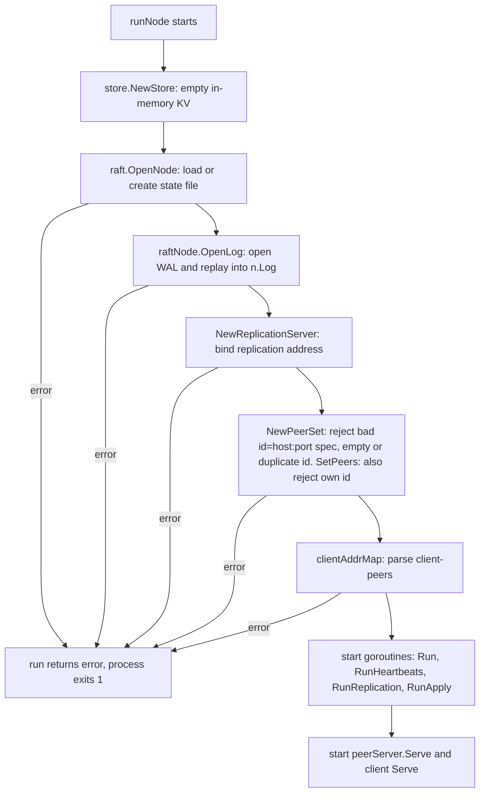
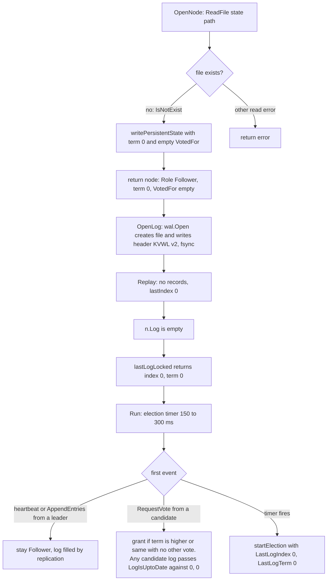
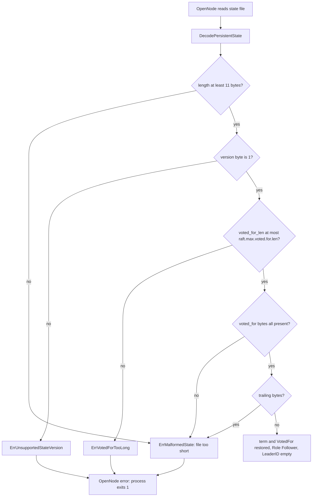
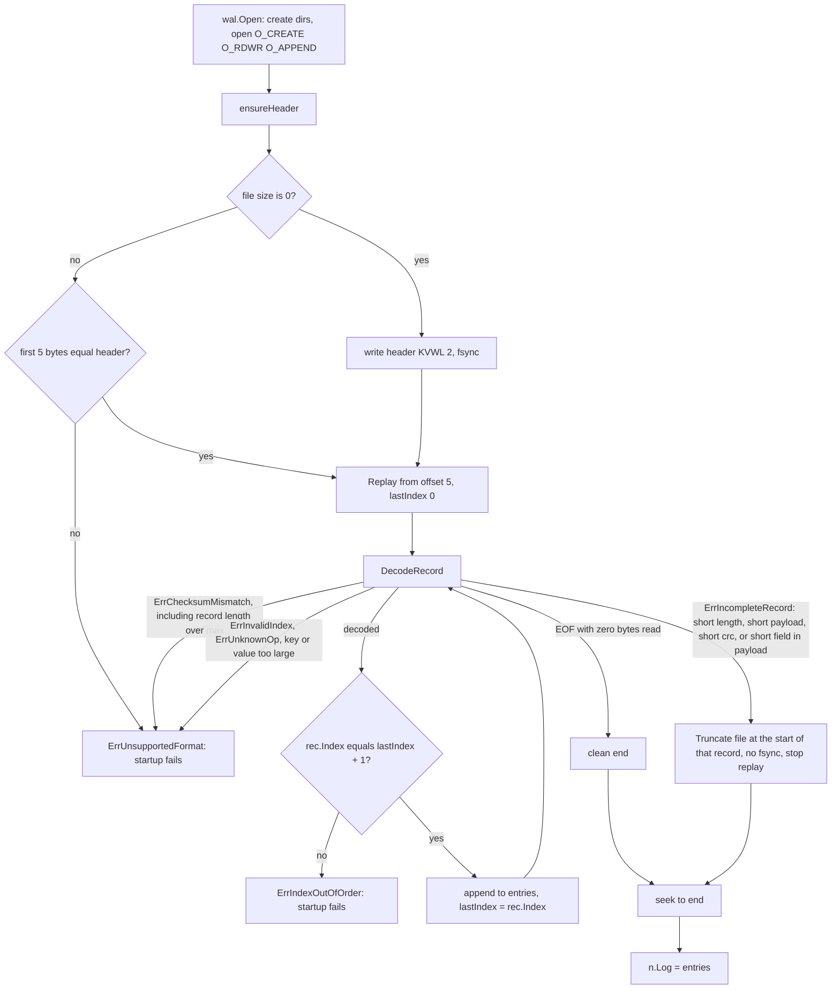
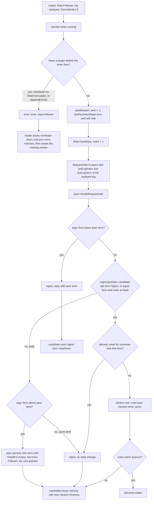
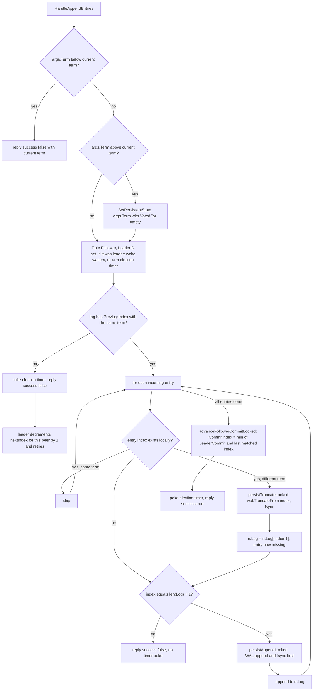
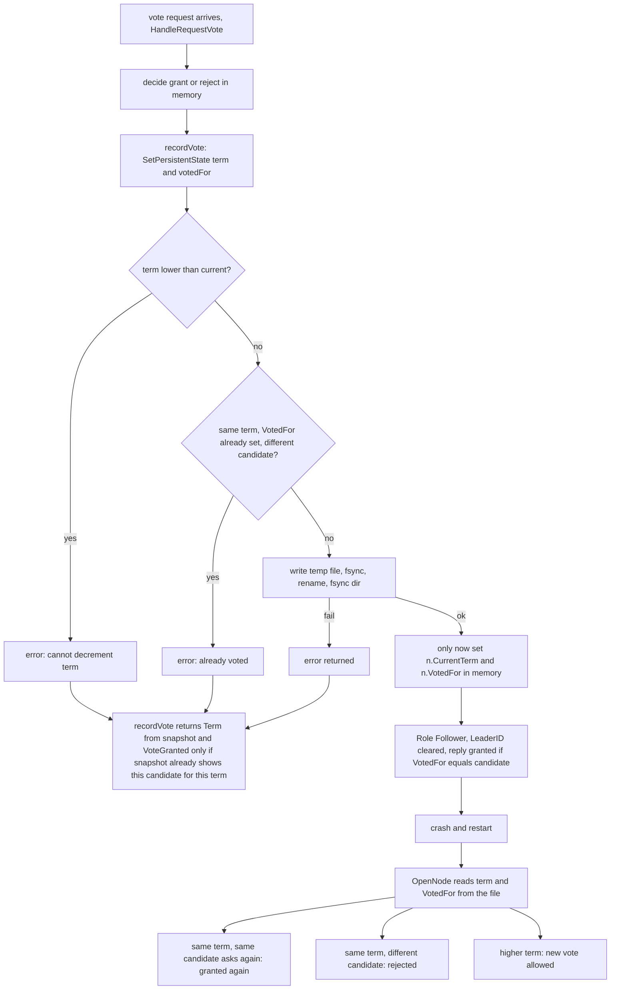

# Node startup: persisted state cases

These diagrams follow the code as it is today, not as Raft says it should be. Sources: `cmd/server/main.go` (`runNode`), `raft/persistent.go`, `raft/logstore.go`, `raft/election.go`, `raft/replicate.go`, `wal/wal.go`, `wal/record.go`, `replication/transport.go`.

There is no `-role` flag. Every node boots as a follower and `Run` decides whether it ever becomes a leader.

Two files per node, both derived from `-wal` (default `data/<node-id>.wal`):

| File | Path | Holds |
|---|---|---|
| Raft state | `<wal>-raft.state` | `CurrentTerm`, `VotedFor` |
| Raft log | `<wal>-raft.log` | entries (index, term, op, key, value) |

## Boot order

Things the code does here that are easy to assume otherwise:

- `OpenLog` loads entries into `n.Log` only. It does **not** apply anything to the store.
- `CommitIndex` and `LastApplied` are 0 after every start, including a restart. They are never persisted.
- So the store is empty until a leader's `AppendEntries` raises `CommitIndex` (follower), or the new leader's own no-op commits (leader). Only then does `RunApply` replay entries from index 1.
- `RunHeartbeats` and `RunReplication` start immediately but do nothing while the node is a follower.

## Case 5: fresh node (no state file, no WAL)

Code quirk: a missing state file is treated as "fresh" whatever the log file holds. If the state file is deleted but the log has entries with higher terms, the node boots at term 0 with a non-empty log.

## Case 9: corrupt or partial files

### State file

There is no repair path and no checksum on the state file. A write is a temp file, fsync, rename over the original, then fsync of the directory, so a crash during a write leaves either the old or the new file. A leftover `.raft-state-*` temp file is ignored.

### Raft log (WAL)

So the WAL has exactly two outcomes: a torn tail is silently dropped and the node boots with the shorter log, and anything else that is wrong fails startup. The first record must have index 1.

## Case 6: restart with a stale log

A restarted node does not hold back from elections because its log is behind. The check is on the **receiving** side.

What the code does here that Raft's text may not suggest:

- A stale node still increments its term and persists a self-vote. It just cannot win.
- A peer that receives that higher-term `RequestVote` persists the new term and drops to follower even when it refuses the vote. If that peer was the leader, `recordVote` sets it to follower, so a stale node that stops hearing heartbeats can depose a healthy leader.
- A peer grants the vote only when the candidate's log is at least as up to date as the peer's own (`LogIsUptoDate`), and it has not voted for someone else this term.

## Case 7: restart with a divergent suffix

Happens on a follower when the new leader's log disagrees with the uncommitted tail left in this node's WAL.

Notes on what the code does:

- `TruncateFrom` does not rewrite the file. It scans records from the start until it reaches the first record at or after the index, then calls `Truncate` and `Sync`. Cost is proportional to the prefix scanned.
- `CommitIndex` is never lowered, and the store is not rebuilt after a truncate. That is safe only because a committed entry is never in the truncated range.
- Commit is capped at what this RPC matched (`matchedThrough`), so a follower never commits entries the leader has not confirmed match.
- A WAL write or truncate error returns an error to the transport, which closes the connection with no reply.

## Case 8: restart after a vote

- The reply is built after the fsync, so a vote the candidate sees is on disk.
- A persistence failure is turned into a "not granted" reply (or a repeat grant if the same candidate already holds the vote). `recordVote` swallows the error and returns `nil`, so `HandleRequestVote` never returns a persistence error here. The transport also discards that return with `res, _ :=` ([replication/transport.go:552](../replication/transport.go)).
- A candidate's own self-vote follows the same rule: `startElection` persists `term+1` and `VotedFor = self` before it sends any request.
- On restart the node is always a follower with an empty `LeaderID`. A leader that restarts does not remain leader.

## Case-by-case summary

| Case | What the code does |
|---|---|
| 5 fresh node | writes a zero state file, creates a header-only WAL, boots at term 0 with an empty log |
| 6 stale log | may still start elections, since peers apply `LogIsUptoDate`, and each attempt bumps terms on peers that reject |
| 7 divergent suffix | follower truncates WAL and memory from the first conflicting index, then appends the leader's entries |
| 8 restart after vote | term and `VotedFor` come back from the state file, so a second vote in the same term is refused |
| 9 corruption | state file: any decode error is fatal. WAL: torn tail truncated, checksum, header, index, or op errors are fatal |
