# Node startup: persisted state cases

These diagrams follow the code as it is today, not as Raft says it should be. Sources: `cmd/server/main.go` (`runNode`), `raft/persistent.go`, `raft/state_record.go`, `raft/snapshot.go`, `raft/logstore.go`, `raft/election.go`, `raft/replicate.go`, `raft/apply.go`, `wal/wal.go`, `wal/record.go`, `replication/transport.go`.

There is no `-role` flag. Every node boots as a follower and `Run` decides whether it ever becomes a leader.

Three paths per node, all derived from `-wal` (default `data/<node-id>.wal`):

| Path | Holds |
|---|---|
| `<wal>-raft.state` | `CurrentTerm`, `VotedFor` |
| `<wal>-raft.snap` | latest snapshot: header (`KVSN`, version 1, last included index, last included term), state machine payload (client dedup table and KV pairs), CRC32 of everything before it |
| `<wal>-raft.log/` | WAL directory of segment files named `<20-digit seq>.wal`. Each segment starts with the header `KVWL 3` and holds records (index, term, op, key, value, and client id and seq for client writes) |

Temp files written next to these (`.raft-state-*`, `.raft-snap-*`, `.raft-snap-recv-*`) are never read at startup. A leftover one from a crash is ignored, not cleaned up.

## Boot order

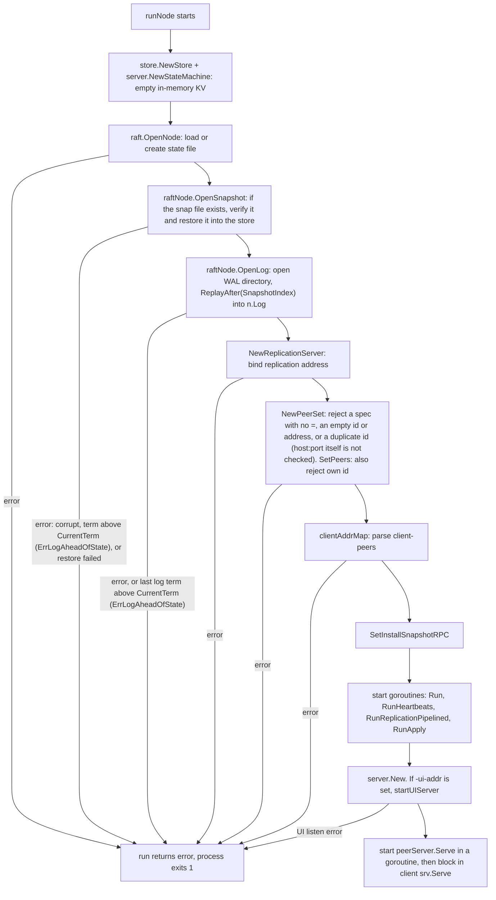

Things the code does here that are easy to assume otherwise:

- `OpenSnapshot` runs before `RunApply` exists, so the snapshot is restored into the store on the main goroutine, during boot.
- `OpenLog` loads entries after `SnapshotIndex` into `n.Log` only. It does **not** apply anything to the store.
- `CommitIndex` and `LastApplied` are never persisted. After every start they equal `SnapshotIndex` (0 when there is no snapshot).
- So the store holds exactly the snapshot state until a leader's `AppendEntries` raises `CommitIndex` (follower), or the new leader's own no-op commits (leader). Only then does `RunApply` apply entries from `SnapshotIndex + 1`. Heartbeats do not carry the commit index, but an idle leader re-sends its commit index to each caught-up peer every `commitRefreshInterval` (`electionTimeoutMin`), so a restarted follower catches up without waiting for a new write.
- `RunHeartbeats` and `RunReplicationPipelined` start immediately but do nothing while the node is a follower.

## Case 5: fresh node (no state file, no snapshot, no WAL)

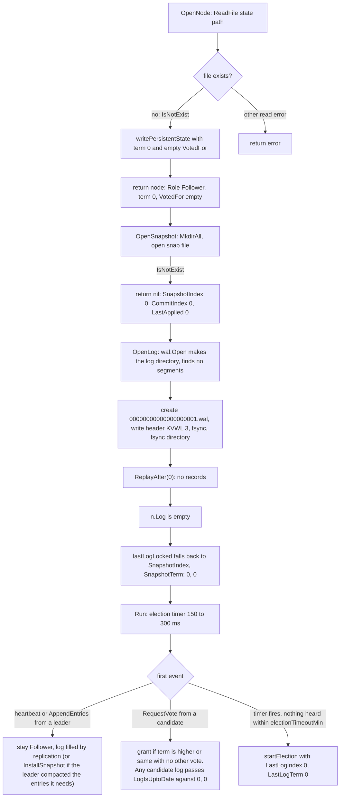

A missing state file is recreated at term 0 whatever the snapshot and log hold. The next two steps catch the mismatch: `OpenSnapshot` fails if the snapshot's last included term is above the stored `CurrentTerm`, and `OpenLog` fails if the last log entry's term is above it. Both return `ErrLogAheadOfState` and startup fails. That state can only come from a deleted or rolled-back state file, so votes this node already cast are lost, and booting could let it vote twice in one term. The fix is manual: remove the state file, the snapshot file, and the log directory, so the node rejoins empty and is filled by the leader.

The check cannot catch a lost vote in a term later than the last log entry or snapshot, because votes are not written to either. The state file must never be deleted on its own.

## Case 9: corrupt or partial files

### State file

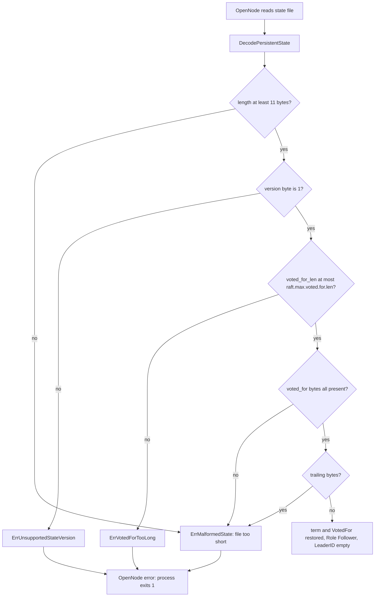

There is no repair path and no checksum on the state file. A write is a temp file, fsync, rename over the original, then fsync of the directory, so a crash during a write leaves either the old or the new file.

### Snapshot file

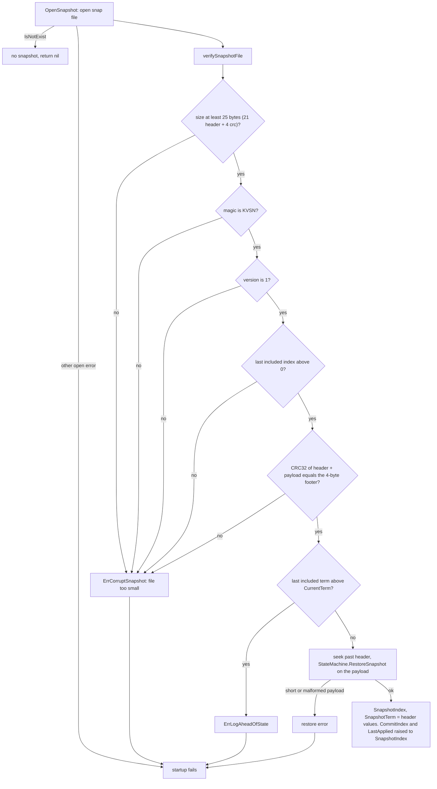

Any problem with the snapshot file fails startup. There is no fallback to an older snapshot or to the WAL alone, and that would not work anyway once segments up to the snapshot have been compacted away.

### Raft log (WAL directory)

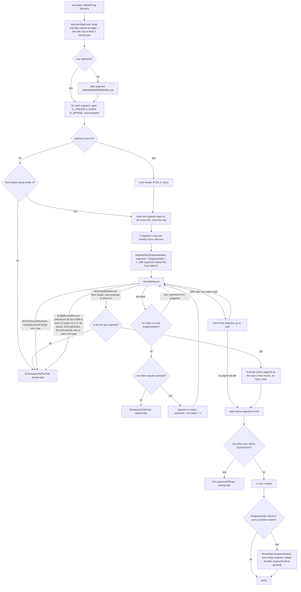

Notes:

- Every segment's header is checked, not only the active one. Only `KVWL 3` is accepted, so an old v2 file now fails with `ErrUnsupportedFormat`. Files in the directory that do not match the segment name pattern are ignored.
- A record payload may end with a 16-byte trailer holding the client id and sequence number, written only when the client id is not 0. Anything other than 0 or 16 trailing bytes is `ErrMalformedRecord`.
- Records at or below `SnapshotIndex` are skipped without any order check. Order is enforced only from `SnapshotIndex + 1`, and the first record after the snapshot must be exactly that index.
- So a lost snapshot file with a compacted WAL fails startup: replay expects index 1, finds the first kept index (for example 977), and returns `ErrIndexOutOfOrder`.

So the WAL has exactly two outcomes: a torn tail in the **last** segment is silently dropped and the node boots with the shorter log, and anything else that is wrong fails startup. A torn record in an older segment is fatal, because only the active segment is ever appended to. A record whose bytes are all present and whose checksum matches, but whose payload is too short for its fields, is `ErrMalformedRecord` and fails startup, so valid records after it are never truncated.

## Case 10: restart with a snapshot

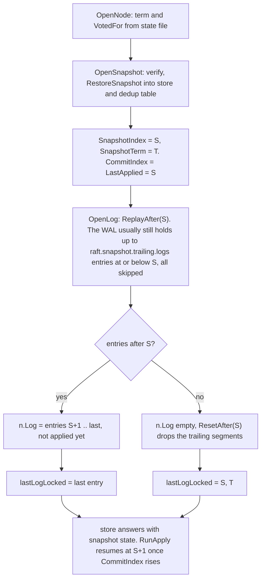

- Reads served by this node see the snapshot's state at once, before any leader contact.
- The in-memory log only starts after the snapshot, so `logTermAtLocked` knows the term of `S` (from `SnapshotTerm`) and of entries after it, nothing earlier.
- As a leader, a peer whose `nextIndex - 1` is below the first entry this node still holds gets `appendNeedSnapshot`, and `sendSnapshotToPeer` streams the snapshot file in `raft.snapshot.chunk.bytes` chunks instead.

## Case 11: crash during a snapshot

### Local snapshot (`finishLocalSnapshot`, started from `RunApply`)

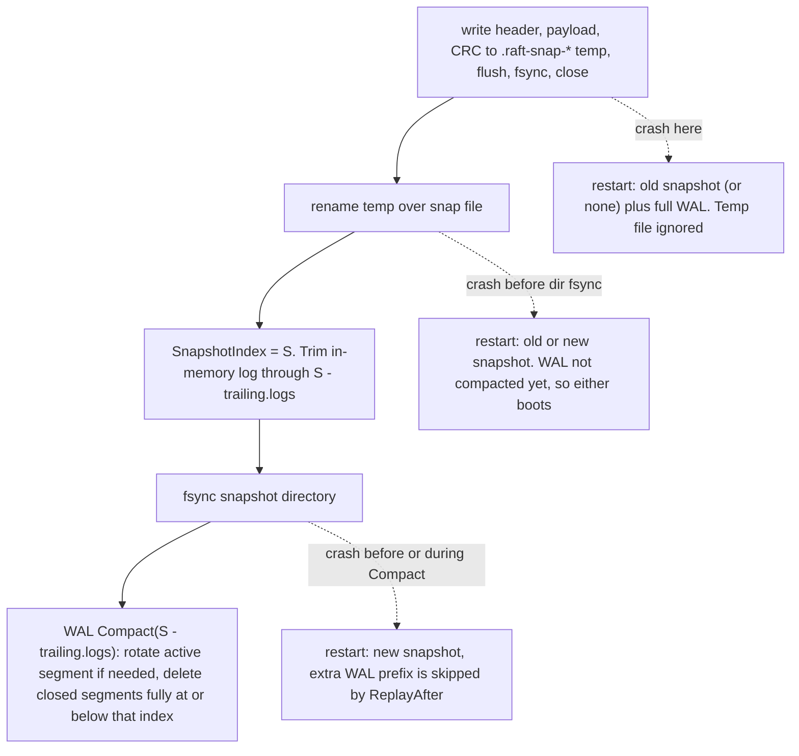

The directory fsync comes before any segment is deleted, so a crash can never leave a compacted WAL without the snapshot that covers it. Segment deletion itself is not followed by a directory fsync, so a deleted segment can come back after a crash. That is harmless: its records are at or below `SnapshotIndex` and are skipped.

### Received snapshot (`HandleInstallSnapshot`)

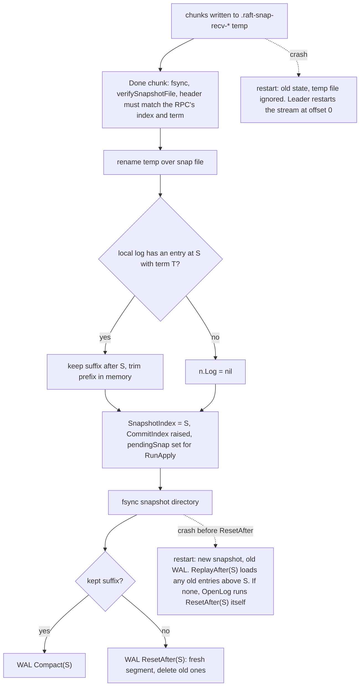

In the `R2` case, old entries above `S` that disagree with the leader stay in the log until the next `AppendEntries` finds the conflict and truncates them (Case 7).

## Case 6: restart with a stale log

A restarted node does not hold back from elections because its log is behind. The check is on the **receiving** side.

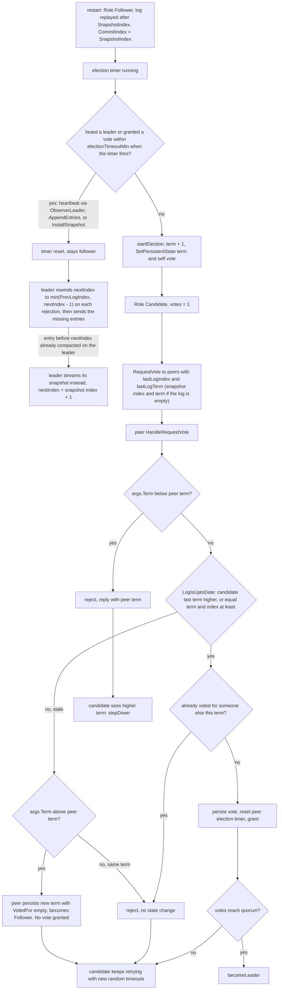

What the code does here that Raft's text may not suggest:

- A stale node still increments its term and persists a self-vote. It just cannot win.
- A peer that receives that higher-term `RequestVote` persists the new term and drops to follower even when it refuses the vote. If that peer was the leader, `recordVote` sets it to follower and re-arms its election timer, so a stale node that stops hearing heartbeats can depose a healthy leader.
- A peer grants the vote only when the candidate's log is at least as up to date as the peer's own (`LogIsUptoDate`), and it has not voted for someone else this term. Both sides compare their last entry, or their snapshot's index and term when the in-memory log is empty.

## Case 7: restart with a divergent suffix

Happens on a follower when the new leader's log disagrees with the uncommitted tail left in this node's WAL.

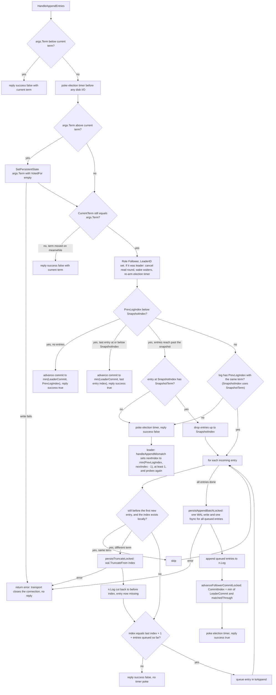

Notes on what the code does:

- `TruncateFrom` first drops whole trailing segments whose records all sit at or after the index (keeping at least one segment) and deletes those files. Then it scans the remaining active segment from its header to the first record at or after the index, calls `Truncate` and `Sync`. Cost is proportional to the active segment, not the whole log. Deleted segments are not followed by a directory fsync.
- Conflicts are only checked until the first entry is queued. After that every entry must simply be the next index.
- `CommitIndex` is never lowered, and the store is not rebuilt after a truncate. That is safe only because a committed entry is never in the truncated range.
- Commit is capped at what this RPC matched (`matchedThrough` is `PrevLogIndex`, or the last entry the leader sent), so a follower never commits entries the leader has not confirmed match.
- Entries at or below `SnapshotIndex` are never truncated or rejected: they are covered by the snapshot.
- A WAL write or truncate error returns an error to the transport, which closes the connection with no reply.

## Case 8: restart after a vote

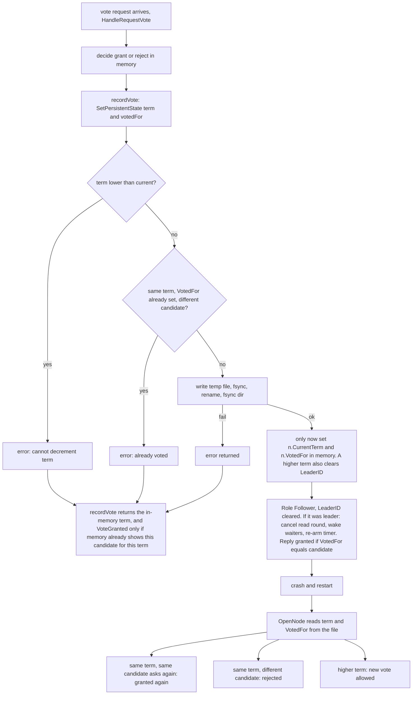

- The reply is built after the fsync, so a vote the candidate sees is on disk.
- A persistence failure is turned into a "not granted" reply (or a repeat grant if the same candidate already holds the vote). `recordVote` swallows the error and returns `nil`, so `HandleRequestVote` never returns a persistence error here. The transport also discards that return with `res, _ :=` (`serveReplicationConnection` in [replication/transport.go](../replication/transport.go)).
- A candidate's own self-vote follows the same rule: `startElection` persists `term+1` and `VotedFor = self` before it sends any request.
- On restart the node is always a follower with an empty `LeaderID`. A leader that restarts does not remain leader.

## Case-by-case summary

| Case | What the code does |
|---|---|
| 5 fresh node | writes a zero state file, finds no snapshot, creates the log directory with one header-only segment, boots at term 0 with an empty log |
| 6 stale log | may still start elections, since peers apply `LogIsUptoDate`, and each attempt bumps terms on peers that reject. The leader catches it up with entries, or with its snapshot if those entries are compacted |
| 7 divergent suffix | follower truncates WAL and memory from the first conflicting index, then appends the leader's entries in one batch. Entries covered by the snapshot are never touched |
| 8 restart after vote | term and `VotedFor` come back from the state file, so a second vote in the same term is refused |
| 9 corruption | state file: any decode error is fatal. Snapshot: bad size, magic, version, zero index, CRC, or restore is fatal. A snapshot or log whose term is above the stored term (missing or rolled-back state file) is fatal. WAL: torn tail in the last segment is truncated; torn record in an older segment, checksum, malformed payload, header, index, or op errors are fatal |
| 10 restart with snapshot | store is restored from the snapshot at boot, `CommitIndex = LastApplied = SnapshotIndex`, only entries after it are replayed into memory |
| 11 crash mid-snapshot | the snapshot directory is fsynced before any WAL segment is deleted, so every crash point leaves a snapshot plus a WAL that boots. Leftover temp files are ignored |
