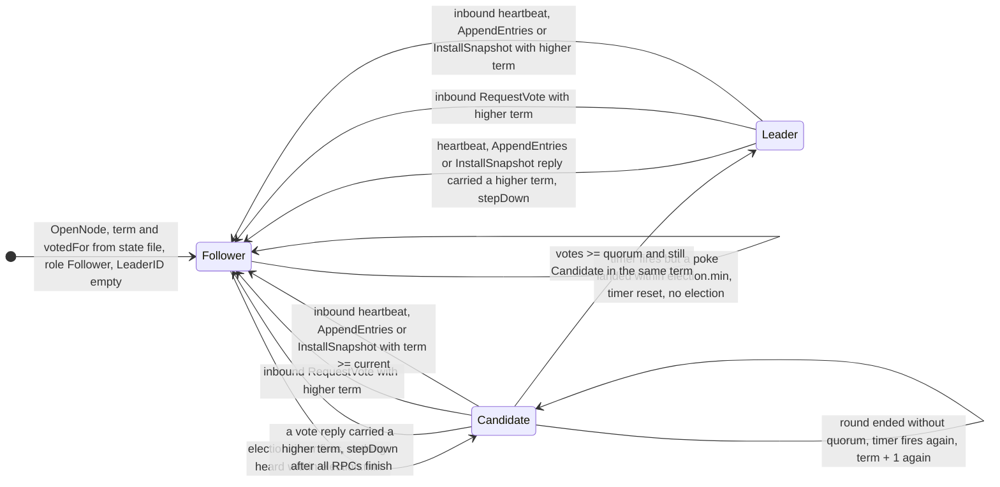
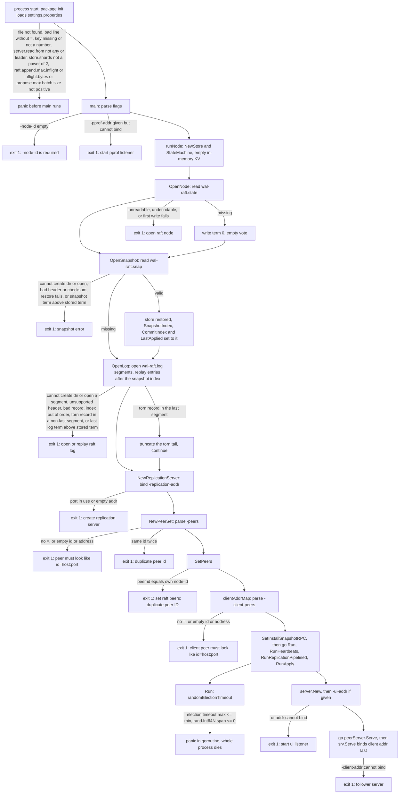
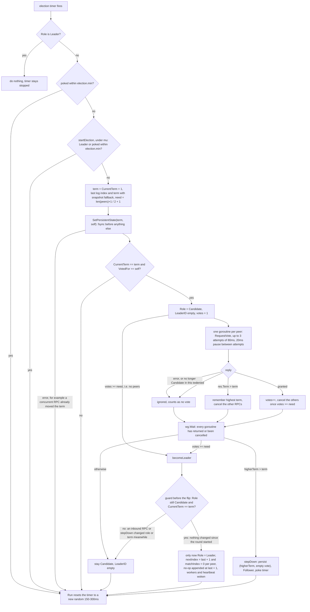
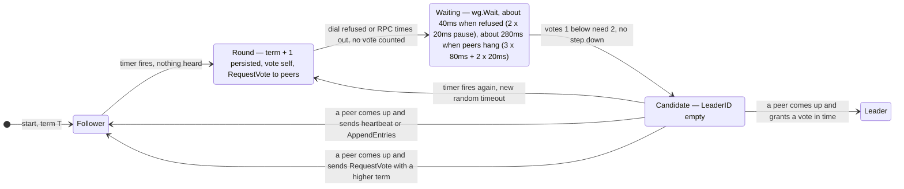
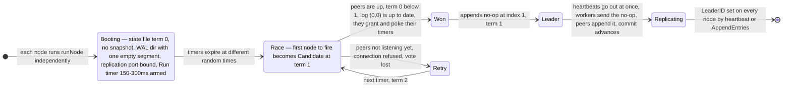
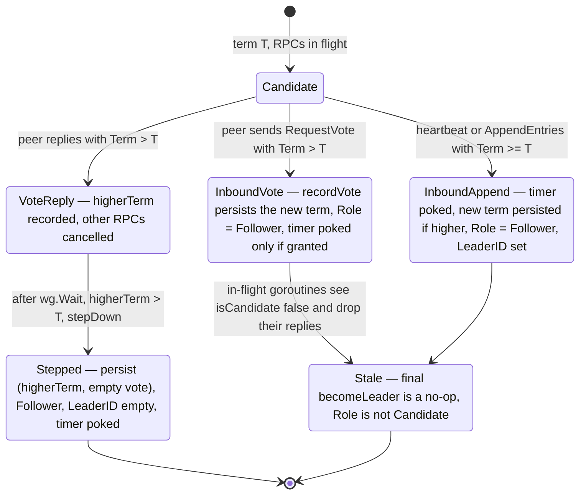
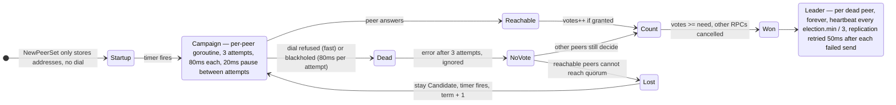

# Cluster-dependent startup cases

Every diagram here was written from the code as it is today, not from the Raft paper. It was read from `cmd/server/main.go`, `config/config.go`, `raft/election.go`, `raft/persistent.go`, `raft/cluster.go`, `raft/logstore.go`, `raft/snapshot.go`, `raft/replicate.go`, `wal/wal.go`, `replication/transport.go`, `replication/peers.go` and `server/server.go`. Nothing was run to produce it. Where the code departs from textbook Raft, the text says so.

Every node starts the same way. There is no `-role` flag: `main` logs "starting this as a follower Node" and calls `runNode`. A leader exists only because an election was won. See [2. node-startup.md](2.%20node-startup.md) for the boot sequence and role state machine.

## Base: role lifecycle

All six cases below are paths through this one machine.

Facts the diagram depends on:

- **Timer.** `Run` re-arms it on every `electionReset` poke. When it fires and the node is Leader, `Run` does nothing and leaves the timer stopped. Every leader-to-follower path pokes `electionReset` to re-arm it.
- **Heard recently.** `pokeElectionTimer` also stamps `lastHeard`. When the timer fires, `Run` skips the election and resets the timer if that stamp is less than `election.timeout.min` old, and `startElection` checks the same thing again once it holds `mu`. This only stops the local node from campaigning. It is not PreVote, and voters do not use it to refuse a vote.
- **Persistence.** `SetPersistentState` fsyncs the state file (temp file, rename, dir sync) before the in-memory term or vote changes. It refuses a lower term, and it refuses a different vote in a term that already has one. A term change also clears `LeaderID`. A term can never go down.
- **Leader no-op.** `becomeLeader` appends a no-op entry in the new term, so entries from earlier terms can commit. In a single-node cluster it commits at once. If the WAL write of the no-op fails, the error is only logged and the node stays Leader without it. Either way it wakes every peer replication worker and the heartbeat loop.
- **Candidate is sticky.** A Candidate that fails an election does not fall back to Follower. It stays Candidate with `LeaderID` empty until its timer fires again, or it hears from a leader or a higher term.

## Case 15: bad config, in the order `runNode` hits it

The `-wal` flag defaults to `data/<node-id>.wal`. Three paths are built from it: `<wal>-raft.state` (file), `<wal>-raft.snap` (file) and `<wal>-raft.log` (a directory of WAL segments).

What the code does not check:

- **Election timeout bounds.** Nothing compares min and max. With `max <= min`, `rand.Int64N` panics on the first call, which is inside the `Run` goroutine. By then the state file and WAL exist, and the replication port is bound. A panic skips every `defer`.
- **Empty `-peers`.** It is accepted. Peers is empty, quorum is 1, and the node wins its first election alone.
- **Peer config consistency.** There is no check that peer ids or addresses match what the other nodes use.
- **Address format.** `-peers` and `-client-peers` addresses are not checked to be `host:port`. Only a missing `=` or an empty side fails at boot. A bad peer address fails later, on the first dial.
- **Error exits.** A returned error is printed and exits 1 through `main`. `defer` closes the peer clients and the raft log, and `cancel()` closes the replication listener through its context. Snapshot and log errors are returned without the `runNode` prefix.
- **Client and UI address.** Both listeners bind after `go Run`, so a bad `-ui-addr` or `-client-addr` only fails after the node may already have run an election.

## The election round, as coded

Cases 10, 11, 13 and 14 all happen inside this function.

- **Higher term wins.** `higherTerm` is checked before `votes >= need`. If a vote reply carried a higher term, the node steps down even when it also reached quorum.
- **Blocking.** `startElection` blocks the timer loop until every vote goroutine finishes, or is cancelled once quorum or a higher term is seen.
- **Late reset.** `Run` resets the timer after `startElection` returns, so a slow round delays the next timeout. A node that just became Leader also gets this reset, and when it fires `Run` ignores it.
- **Last log.** With an empty in-memory log, the candidate offers `SnapshotIndex` and `SnapshotTerm` as its last log index and term. Voters compare the same way.

## Case 10: split vote

Four nodes A, B, C, D (quorum 3). A and B time out together in term 1 and each votes for itself.

```mermaid
stateDiagram-v2
    direction LR
    state "A — Candidate, term 1, votes 1 (self)" as A1
    state "B — Candidate, term 1, votes 1 (self)" as B1
    state "C granted A in term 1, timer poked" as C1
    state "D granted B in term 1, timer poked" as D1
    state "A — Candidate, term 1, votes 2, round over" as A2
    state "B — Candidate, term 1, votes 2, round over" as B2
    state "A timer fires first — term 2, votes self" as A3
    state "B — RequestVote term 2 is higher, recordVote" as B3
    state "B — Follower, votedFor A, timer poked" as B4
    state "C and D — higher term, grant A, timer poked" as CD
    state "A — votes 3, Leader" as A4

    [*] --> A1
    [*] --> B1
    A1 --> C1: RequestVote to C
    B1 --> D1: RequestVote to D
    C1 --> A2: C grants A, D denies A (D already voted B in term 1)
    D1 --> B2: D grants B, C denies B
    A2 --> A3: random timeout 150-300ms, no one got 3 votes
    B2 --> B3: B has not timed out yet
    A3 --> B3
    B3 --> B4: log up to date, vote granted
    A3 --> CD
    CD --> A4
    B4 --> A4
```

- **Same-term denial.** Same-term `HandleRequestVote` denies if `votedFor` is set to someone else. This is what produces the split, and the denial is not an error. A denial does not poke the timer.
- **Why it resolves.** The next round resolves only because timeouts are random. Whoever fires first bumps the term, and everyone else sees a higher term and re-votes.
- **Voters hold off.** A granted vote pokes the voter's timer, so C and D do not start their own election for at least `election.timeout.min` after granting.
- **Re-vote.** A higher-term RequestVote clears the old vote. If the candidate's log is not up to date, the voter records vote `""` for the new term instead of granting. Its role still becomes Follower, but the timer is not poked (unless it was Leader).
- **No pre-vote.** There is no PreVote. Every failed round increments and persists the term.

## Case 11: no quorum on startup

Only a minority of the cluster is up. Example: 1 of 3 nodes (quorum 2).

- **Candidate stays put.** The node loops Candidate → Candidate, with `CurrentTerm` rising by 1 each time and an fsync each round. Nothing caps the term.
- **Writes.** `proposeRaftWrite` sees a non-Leader with `LeaderID == ""`, so it replies `NotLeader` with an empty hint.
- **Reads.** `server.read.from=any` serves them from the local store. With `leader`, `WaitLeaderRead` returns `ErrNotLeader`, so the reply is `NotLeader` with an empty hint.
- **Disruption on return.** There is no PreVote, and `HandleRequestVote` has no leader check. A node that kept bumping its term and then reconnects sends a higher-term RequestVote. A stable leader that receives it becomes Follower through `recordVote`. If the candidate's log is behind, the leader records vote `""`. Either way, this forces a new election.

## Case 12: simultaneous cold start

All nodes start at about the same time with empty state files, no snapshot and empty WALs.

- **Bind order.** `NewReplicationServer` binds the replication port early, before `go Run`. `Serve()` starts accepting later, after `go Run` and the optional UI bind. Early peer RPCs therefore wait in the kernel backlog instead of being refused, once that node has gotten as far as binding.
- **Not-yet-bound peers.** A node that has not reached the bind gives "connection refused", and the candidate's vote goroutine fails after 3 attempts.
- **First commit.** The first commit is the no-op. When `advanceCommitLocked` moves the commit index, it wakes every replication worker, which sends an empty AppendEntries carrying the new `LeaderCommit`. Followers apply the no-op in `server.StateMachine.Apply`, whose switch only acts on `OpSet` and `OpDel`.
- **Client port.** The client listener binds last, so a node can already be Leader before it accepts clients.

## Case 13: higher term seen mid-election

Three separate paths, all ending in Follower.

- **Same term wins.** The inbound heartbeat or AppendEntries path also fires at an equal term. A Candidate in term T that hears a leader of term T concedes. The heartbeat goes through `ObserverLeader`, whose fast path only covers a same-term Follower, so a Candidate takes the slow path under `mu`.
- **Persisted vote.** The step-down paths write the term, and the vote if any, before changing the role.
- **Stale replies.** `becomeLeader` re-checks `Role == Candidate && CurrentTerm == term`, so a concurrent step-down always wins. Vote replies that arrive after a step-down are discarded by the `isCandidate` check.
- **Before the round starts.** If an inbound RPC moves the term between `startElection` reading `CurrentTerm` and persisting its own vote, `SetPersistentState` either fails or the follow-up `CurrentTerm == term && VotedFor == self` check fails. The round is dropped before the node becomes Candidate.

## Case 14: peer unreachable at startup

A peer is down or slow while this node starts up and campaigns.

- **No startup failure.** A down peer never prevents startup. Each peer gets three clients: `control` (RequestVote and Heartbeat), `append` (single AppendEntries and InstallSnapshot) and `pipeline` (pipelined AppendEntries). Each dials lazily on its first use.
- **Fast election.** With a reachable majority, the election returns as soon as quorum is reached. `electCancel` cancels the stragglers, whose retry loops stop when `ctx.Err() != nil`.
- **No majority.** The election waits for all peers to exhaust their attempts. With a blackholed peer that is about 3 × 80 + 2 × 20 = 280ms.
- **Per-peer lock.** One mutex per `TCPPeerClient` serializes its RPCs. RequestVote and Heartbeat share the `control` client, so a slow vote RPC can briefly delay a heartbeat to the same peer. AppendEntries uses its own connections and is not affected.
- **After winning: heartbeats.** One heartbeat worker per peer sends one at once, then every `election.timeout.min / 3` (50ms). Each heartbeat is up to 2 attempts of 50ms with a 5ms pause (no pause after a stale-connection error). Errors are ignored, and the tick is pushed back after every heartbeat, so to a blackholed peer one heartbeat takes about 105ms, then the next goes out 50ms later.
- **After winning: replication.** The pipeline worker dials with a 500ms timeout, and every queued AppendEntries has a 500ms read deadline. A failed dial, write or reply rewinds to the oldest unacknowledged entry, drops back to Probe mode (one request in flight) and waits `raft.append.retry.backoff.ms` (50ms) before the next try. It retries forever.

### Catch-up gap

Repair of a follower's log is driven only by AppendEntries and InstallSnapshot, never by heartbeats. Heartbeats carry only the term and leader id, call `ObserverLeader`, and carry no commit index.

- **Right after an election.** `nextIndex` starts at the leader's `lastIndex + 1` (the snapshot index when the log is empty) and the no-op is appended, so a first AppendEntries goes out with the no-op.
- **Walk-back.** A failed `prevLogIndex` check sets `nextIndex` to the rejected `PrevLogIndex` when that is lower, otherwise lowers it by one, never below 1, and the worker drops back to Probe mode. The follower sends no conflict hint, so this goes back one entry per round trip.
- **Behind the snapshot.** If the entry before `nextIndex` was compacted into the leader's snapshot, the worker drains its pipeline and streams InstallSnapshot over the `append` client. On success it resumes at `snapshotIndex + 1`. On failure it waits 50ms and tries again.
- **Idle refresh.** When a peer's worker has nothing to send, it waits for a wake-up, a reply, or `electionTimeoutMin` (150ms). When that timer fires it forgets what commit index the peer has acknowledged and, if `min(CommitIndex, matchIndex)` is above zero, sends an empty AppendEntries (`PrevLogIndex = matchIndex`, `LeaderCommit`). A follower that restarted with its log raises `CommitIndex` from it. A follower that lost its log fails the `prevLogIndex` check, so `nextIndex` walks back and the missing entries are sent. A peer whose `matchIndex` is still 0 gets no refresh. The acknowledged commit index is also forgotten when the leader's term changes or an append is rejected.
- **nextIndex after a walk-back.** A successful append moves `nextIndex` to `lastSent + 1` only if that is higher, so out-of-order replies never move it back. This still happens when `matchIndex` is already higher from before the follower lost its log. `matchIndex` itself never goes down.
