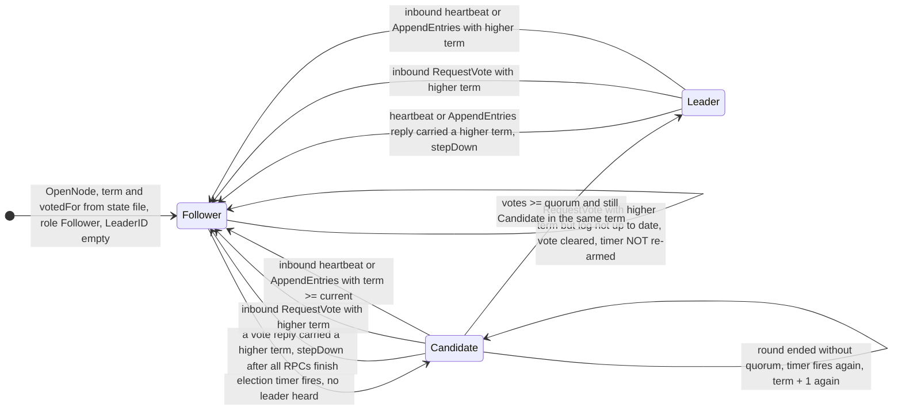
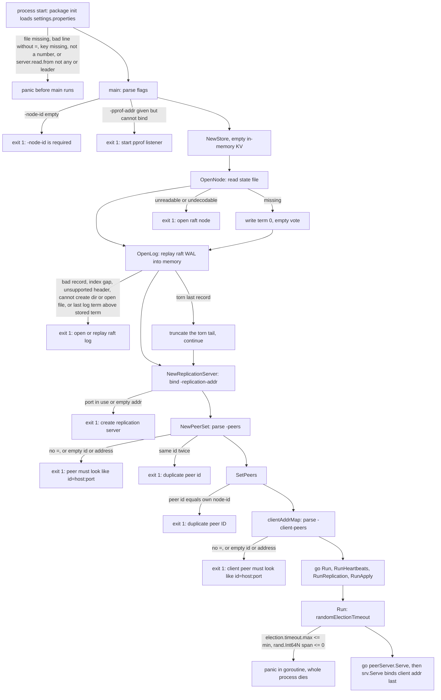
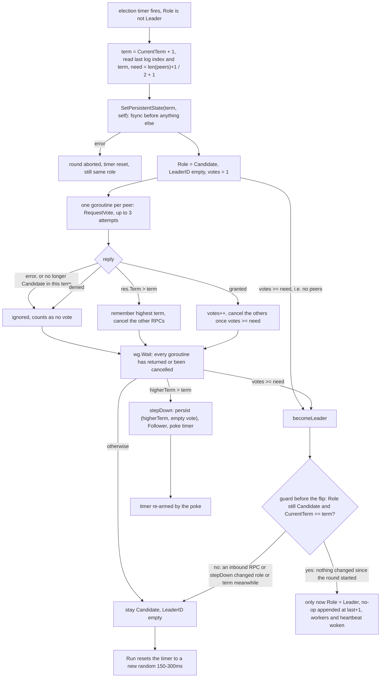
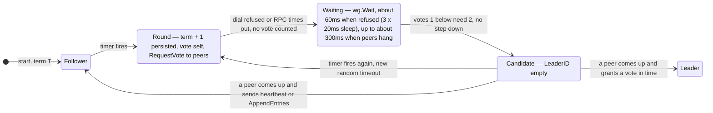
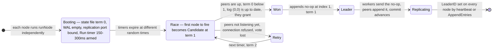
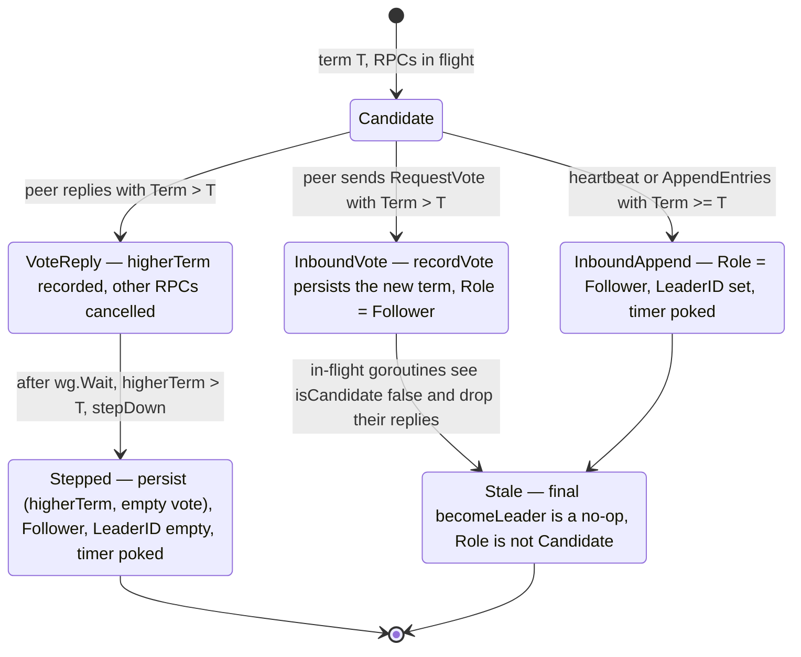
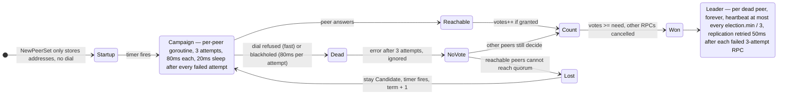

# Cluster-dependent startup cases

Every diagram here was written from the code as it is today, not from the Raft paper. It was read from `cmd/server/main.go`, `raft/election.go`, `raft/replicate.go`, `raft/persistent.go`, `replication/transport.go` and `replication/peers.go`. Nothing was run to produce it. Where the code departs from textbook Raft, the text says so.

Every node starts the same way. There is no `-role` flag: `main` logs "starting this as a follower Node" and calls `runNode`. A leader exists only because an election was won. See [2. node-startup.md](2.%20node-startup.md) for the boot sequence and role state machine.

## Base: role lifecycle

All six cases below are paths through this one machine.

Facts the diagram depends on:

- **Timer.** `Run` re-arms it on every `electionReset` poke. When it fires and the node is Leader, `Run` does nothing and leaves the timer stopped. Every leader-to-follower path pokes `electionReset` to re-arm it.
- **Persistence.** `SetPersistentState` fsyncs the state file (temp file, rename, dir sync) before the in-memory term or vote changes. A term can never go down.
- **Leader no-op.** `becomeLeader` appends a no-op entry in the new term, so entries from earlier terms can commit. It also wakes every peer replication worker and the heartbeat loop.
- **Candidate is sticky.** A Candidate that fails an election does not fall back to Follower. It stays Candidate with `LeaderID` empty until its timer fires again, or it hears from a leader or a higher term.

## Case 15: bad config, in the order `runNode` hits it

What the code does not check:

- **Election timeout bounds.** Nothing compares min and max. With `max <= min`, `rand.Int64N` panics on the first call, which is inside the `Run` goroutine. By then the state file and WAL exist, and the replication port is bound.
- **Empty `-peers`.** It is accepted. Peers is empty, quorum is 1, and the node wins its first election alone.
- **Peer config consistency.** There is no check that peer ids or addresses match what the other nodes use.
- **Address format.** `-peers` and `-client-peers` addresses are not checked to be `host:port`. Only a missing `=` or an empty side fails at boot. A bad peer address fails later, on the first dial.
- **Error exits.** A returned error exits 1 through `main`. `defer` closes the WAL, and `cancel()` closes the replication listener through its context.
- **Client address.** The client listener binds last, so a bad `-client-addr` only fails after the node has been running elections.

## The election round, as coded

Cases 10, 11, 13 and 14 all happen inside this function.

- **Higher term wins.** `higherTerm` is checked before `votes >= need`. If a vote reply carried a higher term, the node steps down even when it also reached quorum.
- **Blocking.** `startElection` blocks the timer loop until every vote goroutine finishes, or is cancelled once quorum or a higher term is seen.
- **Late reset.** The timer is reset after `startElection` returns, so a slow round delays the next timeout.

## Case 10: split vote

Four nodes A, B, C, D (quorum 3). A and B time out together in term 1 and each votes for itself.

```mermaid
stateDiagram-v2
    direction LR
    state "A — Candidate, term 1, votes 1 (self)" as A1
    state "B — Candidate, term 1, votes 1 (self)" as B1
    state "C granted A in term 1" as C1
    state "D granted B in term 1" as D1
    state "A — Candidate, term 1, votes 2, round over" as A2
    state "B — Candidate, term 1, votes 2, round over" as B2
    state "A timer fires first — term 2, votes self" as A3
    state "B — RequestVote term 2 is higher, recordVote" as B3
    state "B — Follower, votedFor A, timer re-armed" as B4
    state "C and D — higher term, grant A" as CD
    state "A — votes 3, Leader" as A4

    [*] --> A1
    [*] --> B1
    A1 --> C1: RequestVote to C
    B1 --> D1: RequestVote to D
    C1 --> A2: C grants A, D denies A (D already voted B in term 1)
    D1 --> B2: D grants B, C denies B
    A2 --> A3: random timeout 150-300ms, no one got 3 votes
    B2 --> B3: B has not timed out yet
    A3 --> B3
    B3 --> B4: log up to date, vote granted
    A3 --> CD
    CD --> A4
    B4 --> A4
```

- **Same-term denial.** Same-term `HandleRequestVote` denies if `votedFor` is set to someone else. This is what produces the split, and the denial is not an error.
- **Why it resolves.** The next round resolves only because timeouts are random. Whoever fires first bumps the term, and everyone else sees a higher term and re-votes.
- **Re-vote.** A higher-term RequestVote clears the old vote. If the candidate's log is not up to date, the voter records vote `""` for the new term instead of granting. Its role still becomes Follower, but the timer is not re-armed.
- **No pre-vote.** There is no PreVote. Every failed round increments and persists the term.

## Case 11: no quorum on startup

Only a minority of the cluster is up. Example: 1 of 3 nodes (quorum 2).

- **Candidate stays put.** The node loops Candidate → Candidate, with `CurrentTerm` rising by 1 each time and an fsync each round. Nothing caps the term.
- **Writes.** `proposeRaftWrite` sees a non-Leader with `LeaderID == ""`, so it replies `NotLeader` with an empty hint.
- **Reads.** `server.read.from=any` serves them locally. `leader` returns `NotLeader` with an empty hint.
- **Disruption on return.** There is no PreVote and no leader check. A node that kept bumping its term and then reconnects sends a higher-term RequestVote. A stable leader that receives it becomes Follower through `recordVote`. If the candidate's log is behind, the leader records vote `""`. Either way, this forces a new election.

## Case 12: simultaneous cold start

All nodes start at about the same time with empty state files and empty WALs.

- **Bind order.** `NewReplicationServer` binds the replication port early, before `go Run`. `Serve()` starts accepting later. Early peer RPCs therefore wait in the kernel backlog instead of being refused, once that node has gotten as far as binding.
- **Not-yet-bound peers.** A node that has not reached the bind gives "connection refused", and the candidate's vote goroutine fails after 3 attempts.
- **First write.** The first commit is the no-op. Followers apply it as a no-op in `server.StateMachine.Apply`, which ignores `OpNoop`.
- **Client port.** The client listener binds last, so a node can already be Leader before it accepts clients.

## Case 13: higher term seen mid-election

Three separate paths, all ending in Follower.

- **Same term wins.** The inbound heartbeat or AppendEntries path also fires at an equal term. A Candidate in term T that hears a leader of term T concedes.
- **Persisted vote.** The step-down paths write the term, and the vote if any, before changing the role.
- **Stale replies.** `becomeLeader` re-checks `Role == Candidate && CurrentTerm == term`, so a concurrent step-down always wins. Vote replies that arrive after a step-down are discarded by the `isCandidate` check.

## Case 14: peer unreachable at startup

A peer is down or slow while this node starts up and campaigns.

- **No startup failure.** A down peer never prevents startup. `TCPPeerClient` dials lazily on the first RPC.
- **Fast election.** With a reachable majority, the election returns as soon as quorum is reached. `electCancel` cancels the stragglers, whose retry loops stop when `ctx.Err() != nil`.
- **No majority.** The election waits for all peers to exhaust their attempts. With a blackholed peer that is about 3 × (80 + 20) = 300ms.
- **Per-peer lock.** One mutex per `TCPPeerClient` serializes all RPCs to that peer. A slow vote RPC can briefly delay a heartbeat or AppendEntries to the same peer.
- **After winning.** The leader retries unreachable peers indefinitely. Heartbeat errors are ignored, and a replication error waits 50ms before the next try. Each RPC is itself 3 attempts, so to a dead peer one try takes about 60ms when refused, or about 300ms when blackholed, before that 50ms. Heartbeats to that peer slow down the same way: the 50ms ticker drops ticks while an RPC is stuck.

### Catch-up gap

Repair of a follower's log is driven only by AppendEntries, never by heartbeats. Heartbeats only call `ObserverLeader` and carry no commit index.

- **Right after an election.** `nextIndex` starts at the leader's `lastIndex + 1` and the no-op is appended, so a first AppendEntries goes out. A failed `prevLogIndex` check walks `nextIndex` back one at a time.
- **Idle refresh.** When a peer's replication worker has nothing to send, it waits for a wake-up or `electionTimeoutMin` (150ms). When that timer fires it forgets what commit index it last sent and sends an empty AppendEntries (`PrevLogIndex = matchIndex`, `LeaderCommit`). A follower that restarted with its log raises `CommitIndex` from it. A follower that lost its log fails the `prevLogIndex` check, so `nextIndex` walks back and the missing entries are sent. The commit index sent is also forgotten when the leader's term changes.
- **nextIndex after a walk-back.** A successful append always sets `nextIndex = lastSent + 1`, even when `matchIndex` is already higher from before the follower lost its log. `matchIndex` itself never goes down.
