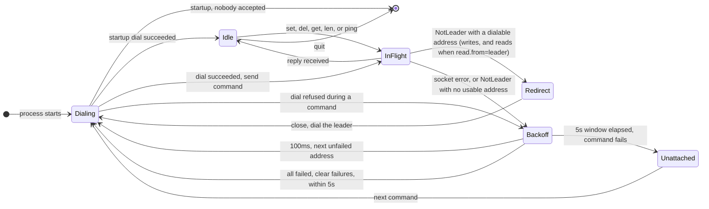

# Client to server connection

The CLI keeps one TCP connection and a list of client addresses (`--9000 --9010 --9020`, or `localhost:9000` when none are given). Startup dials the first member that accepts. A later `SET` or `DEL` is what moves that connection onto the leader. `GET` and `LEN` read the connected node's local store by default, or follow the same redirect to the leader when `server.read.from=leader`. `PING` always stays on the connected node.

**Backoff** covers the 100ms pause and the "every address failed" wait. It dials the next unfailed address, or clears the failed set and starts over, until the 5s window ends.

## Read setting

`server.read.from` in `settings.properties` decides where `GET` and `LEN` are answered. The server enforces it, and the client simply follows any `NotLeader` it receives.

| Value | Behaviour |
|---|---|
| `any` (default) | The connected node answers from its own store. A follower can be behind the leader. |
| `leader` | A follower answers `NotLeader` plus the leader's client address, and the client redirects and resends, exactly as for a write. Only the leader reads. |

`leader` removes follower staleness but is not fully linearizable: a deposed leader that has not yet noticed can still answer briefly. `PING` is never redirected.

`NotLeader` carries the leader's client address when this node has it in `-client-peers`. An empty value means no leader is known yet. A bare node id is not dialable, so the client treats it the same as an empty hint and tries the other members. A dialable address is remembered and can be used again after a later failure.

Startup (`connectAny`) tries each address once and exits if nobody accepts. The 5s retry window and the 100ms pause apply only after a command has started (`session.Do`).

## First connection, then the leader

1. **Unattached → Dialing → Idle.** Dial members in the order given. Stay on the first node that accepts, whether it is the leader or a follower.
2. The first `SET` or `DEL` goes out on that socket.
3. A follower answers `NotLeader` plus the leader's client address. **InFlight → Redirect → Dialing → InFlight** resends the same write.
4. The leader answers `OK`. The session stays **Idle** on that address, so later commands start there.

With `server.read.from=any`, a `GET` during this phase does not take the redirect and is answered by whichever node accepted the first dial. With `leader`, it redirects like a write.

## Normal set

**Idle → InFlight → Idle**, on the leader.

The leader proposes the entry and answers `OK` only after a majority has it and this node has applied it. The client prints `OK` and keeps the socket. A commit timeout comes back as a server error and is also final: the client does not look for another node.

If this socket is still a follower, the write takes the redirect path above before it can complete.

## Normal get

**Idle → InFlight → Idle**, on the current node.

With `server.read.from=any`, any member serves `GET` from its own store. `OK` prints the value. A missing key is `NotFound` and prints `key not found`. Neither status moves the connection. A follower can therefore answer a read that is behind a write the leader has already acknowledged.

With `server.read.from=leader`, a follower answers `NotLeader` and the read follows the redirect path, so the answer comes from the leader.

`LEN` follows the same rule. `PING` always uses the connected node.

## Leader stopped

The dead leader's next read or write returns a socket error.

1. **InFlight → Unattached.** That address is marked failed and the socket is closed.
2. **Unattached → Dialing.** The next address that is not in the failed set is dialed, and the same command is sent.
3. A survivor that is already the new leader answers `OK` for a write, or serves a read locally. The session is **Idle** on that node.
4. A survivor that is still a follower answers a write with `NotLeader` and the new leader's client address. **Redirect → Dialing** follows it and resends the write.
5. If the hint is empty, a node id, or an address already marked failed, **InFlight → WaitHint**. This node stays failed. After 100ms the client dials the next address that is not failed.
6. When no such address remains, **WaitAll** sleeps 100ms, clears the failed set, and tries the list again. The command stops when it succeeds or the 5s window ends. The prompt returns with no socket open. The next command starts again at **Unattached → Dialing**.

With `server.read.from=any`, a `GET` uses steps 1–3 only. It is answered by the next node that accepts the dial and does not chase a `NotLeader` hint. With `leader`, steps 4–6 apply to reads too.
